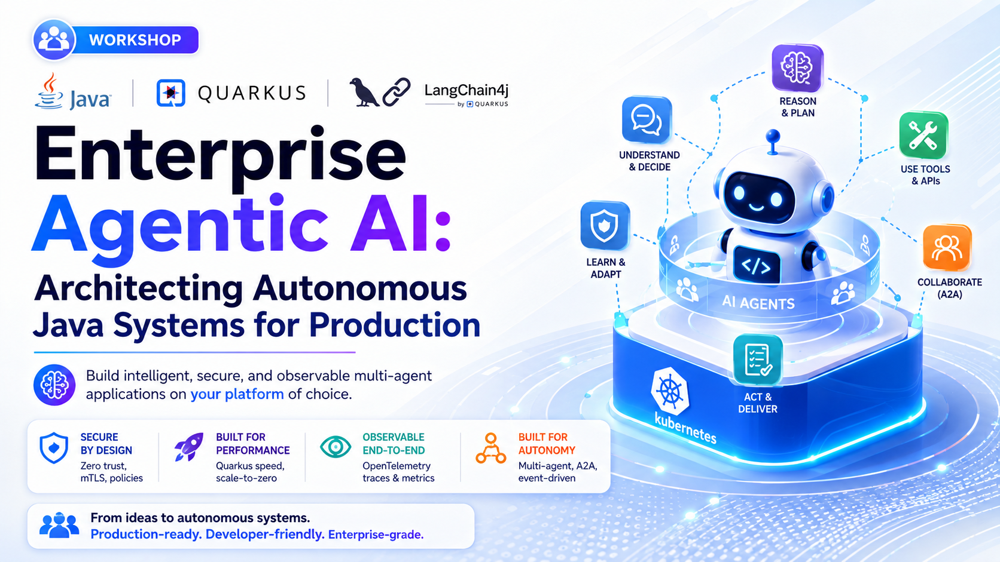

[](https://github.com/danieloh30/agentic-ai-java-workshop/actions/workflows/docs.yml)

# Enterprise Agentic AI: Architecting Autonomous Java Systems for Production

**Hands-On Workshop**  
**Part 1:** 90 minutes (10 min intro · 80 min hands-on), plus an optional 15-minute bonus<br>
**Part 2:** 90-minute event slot (75 min labs · 10 min introduction/transitions · 5 min troubleshooting)<br>
**Part 3:** 90-minute event slot (75 min labs · 15 min introduction/transitions/troubleshooting)<br>
**Lab site:** https://danieloh30.github.io/agentic-ai-java-workshop/ (short URL: [bit.ly/agents-labs](https://bit.ly/agents-labs))  
**Intro deck:** [intro-deck.pdf](docs/images/intro-deck.pdf)

Build an agentic incident management platform for **Apex Systems**, a fictional enterprise IT services company, using **Quarkus**, **Quarkus LangChain4j**, and **OpenCode CLI** or another AI coding assistant. Part 1 introduces agents, tools, orchestration, governance, and observability. Part 2 extends those foundations with MCP-grounded planning, bounded conversational memory and eviction, majority-or-review voting, and persisted event-processing outcomes. Part 3 carries an incident response through runtime skills, guardrails, durable approval, restart recovery, deterministic regression checks, and quality evaluation.

## Learning path

### Part 1 — Fundamental patterns

Build the foundations of agentic incident management for **Apex Systems** through seven short exercises. Start with a declarative agent that calls a tool, then add prompt-based policies, parallel specialists, and supervisor orchestration. Apply coding-assistant governance, introduce human approval and tracing, and delegate impact assessment to a remote agent over A2A.

Designed for a **90-minute session**, with 80 minutes of hands-on work and a 10-minute introduction. **Exercise 8 is an optional 15-minute bonus** that adds a report-quality loop after the core session.

| Exercise and guide | What you will build and verify | Working project | Reference solution |
|--------------------|--------------------------------|-----------------|--------------------|
| [**1. Agent + tool**](docs/01-first-agent/START_HERE.md) | A declarative triage agent that calls a tool to update an incident's status | [Shared lab](lab/) | [Solution](solutions/01-first-agent/) |
| [**2. Policy as prompt**](docs/02-maintenance-agent/START_HERE.md) | A diagnostic agent whose behavior changes through its system message | [Shared lab](lab/) | [Solution](solutions/02-maintenance-agent/) |
| [**3. Parallel agents**](docs/03-parallel-workflow/START_HERE.md) | Concurrent incident analyses combined into a structured result | [Shared lab](lab/) | [Solution](solutions/03-parallel-workflow/) |
| [**4. Supervisor orchestration**](docs/04-supervisor/START_HERE.md) | A supervisor coordinating specialist agents within an incident-processing workflow | [Shared lab](lab/) | [Solution](solutions/04-supervisor/) |
| [**5. AI governance**](docs/05-ai-governance/START_HERE.md) | Project rules in `AGENTS.md` that guide an AI coding assistant and support code and prompt audits | [Shared lab](lab/) | Documentation only |
| [**6. Human gate + tracing**](docs/06-hitl-observability/START_HERE.md) | Human approval for escalation and OpenTelemetry traces of agent execution | [Run + read](solutions/06-hitl-observability/) | [Solution](solutions/06-hitl-observability/) |
| [**7. Remote agents (A2A)**](docs/07-a2a/START_HERE.md) | Impact assessment delegated to a remote agent over A2A | [Main app](solutions/07-a2a/multi-agent-system/) + [remote agent](solutions/07-a2a/remote-a2a-agent/) | [Solution](solutions/07-a2a/) |
| [**8. Quality loop (bonus)**](docs/08-quarkus-flow/START_HERE.md) | A post-incident report drafted, critiqued, and refined until it meets a quality threshold | [Start lab](solutions/08-quarkus-flow/lab/) | [Solution](solutions/08-quarkus-flow/) |

Work through the guides in order. Exercises 1–4 share the root `lab/` project; Exercises 2 and 3 use their reference solutions for end-to-end checks. Exercise 5 audits the current lab, Exercises 6 and 7 use runnable solutions, and Exercise 8 has a separate starter.

### Part 2 — From Patterns to Production

**Six short exercises, one running application.** Choose [`part2/lab/`](part2/lab/) for code-along or [`part2/solution/`](part2/solution/) for the completed run-and-read route. Start Quarkus dev mode once and stay in that folder through Exercises 9–14. Select the exercise mode in the dashboard; save code/configuration edits for automatic hot reload. No reset commands, project copies, branch switches, or manual restarts are part of the walkthrough.

The six exercises provide **75 minutes of hands-on work in a 90-minute session**. PostgreSQL, Kafka, and the bundled MCP fixture start up front. Existing incident, conversation, and processing records remain available through dev-mode reloads.

| Exercise and guide | Time | What you build and verify | Dashboard mode |
|--------------------|------|---------------------------|----------------|
| [**9. Structured Planning**](docs/09-plan-execute/START_HERE.md) | 15 min | Validated specialist plans, bounded review, and explicit recommendation readiness | Planning / MCP |
| [**10. Required MCP Evidence**](docs/10-mcp-evidence/START_HERE.md) | 10 min | A required tool lookup before planning; fail closed when evidence is unavailable | Planning / MCP |
| [**11. Memory Boundaries**](docs/11-memory-tiering/START_HERE.md) | 10 min | Conversation isolation and observable eviction from the PostgreSQL-backed window | Memory |
| [**12. Voting and Disagreement**](docs/12-consensus-voting/START_HERE.md) | 15 min | Parallel specialist ballots and deterministic majority-or-review policy | Voting |
| [**13. Event-Driven Processing**](docs/13-event-driven/START_HERE.md) | 10 min | A sequential agent workflow triggered by Kafka, with correlated outcomes | Events / Replay |
| [**14. Persistent Outcomes and Replay**](docs/14-persistent-outcomes/START_HERE.md) | 15 min | Reuse completed work after hot reload and inspect durable, duplicate-safe outcomes | Events / Replay |

Missing MCP evidence stops planning; eviction removes messages from the store; disagreement can require review; a completed recommendation is not proof of incident recovery. Part 3 follows a pending approval across full application shutdown. Optional challenges are outside the core timebox.

### Part 3 — Reliable Response and Evaluation

Six short exercises provide **75 minutes of hands-on work in a 90-minute session**. Choose `part3/lab/` for code-along or `part3/solution/` for completed code, then stay in that folder throughout. The same Apex incident response moves from a runtime skill to a guarded recommendation, asynchronous approval, restart recovery, regression checks, and a measured quality experiment.

The supplied launcher starts persistent PostgreSQL before Quarkus dev mode. Edits use hot reload; **Exercise 18 deliberately restarts the JVM once** to prove a pending approval survives. No reset commands or per-exercise project switches are needed. Evaluation plumbing, the fixed dataset and scripted test server are supplied; learner tasks stay small.

| Exercise | Time | Workspace |
|----------|------|-----------|
| [**15. Runtime Skills**](docs/15-runtime-skills/START_HERE.md) | 10 min | Skills & guardrails |
| [**16. Runtime Output Guardrails**](docs/16-output-guardrails/START_HERE.md) | 10 min | Skills & guardrails |
| [**17. Asynchronous Approval**](docs/17-async-approval/START_HERE.md) | 15 min | Approval & recovery |
| [**18. Restart Recovery**](docs/18-restart-recovery/START_HERE.md) | 15 min | Approval & recovery |
| [**19. Deterministic Regression Tests**](docs/19-regression-tests/START_HERE.md) | 10 min | Tests & evaluation |
| [**20. Quality Evaluation**](docs/20-quality-evaluation/START_HERE.md) | 15 min | Tests & evaluation |

Start with [Exercise 15](docs/15-runtime-skills/START_HERE.md) and preflight dependency/container downloads before the event. Live evaluation uses paid model calls; automated regression tests use a local scripted model and an isolated test database.

## Repository layout

| Path | Purpose |
|------|---------|
| [`lab/`](lab/) | Shared starter project for Exercises 1–4, with TODO stubs |
| [`docs/`](docs/) | All lab instructions (Markdown) and images |
| [`solutions/`](solutions/) | Reference solution projects for each exercise |
| `solutions/08-quarkus-flow/lab/` | Starter project for the optional quality-loop exercise |
| [`part2/lab/`](part2/lab/) | Shared runnable starter for all six Part 2 exercises |
| [`part2/solution/`](part2/solution/) | Completed shared Part 2 application |
| [`part3/lab/`](part3/lab/) | Shared starter for Exercises 15–20 |
| [`part3/solution/`](part3/solution/) | Completed Part 3 application |

For Part 2, edit only the files listed in each guide inside your chosen shared project. The older isolated `solutions/09-*` through `solutions/12-*` folders are retained as historical references, not the current event path.

Start here:

1. **[docs/index.md](docs/index.md)** — lab landing page with exercise table
2. **[solutions/README.md](solutions/README.md)** — exercise → solution mapping

## Quick start

Clone the repository and set the API key:

```bash
git clone https://github.com/danieloh30/agentic-ai-java-workshop.git
cd agentic-ai-java-workshop
export OPENAI_API_KEY=sk-your-key-here
```

For **Part 1**, start Exercise 1:

```bash
cd lab
./mvnw quarkus:dev
```

For **Part 2**, start Exercise 9 from the repository root:

```bash
cd part2/lab
./mvnw quarkus:dev
```

Follow the matching guide, then open [http://localhost:8080](http://localhost:8080). For Part 2, keep the same terminal and project through Exercise 14 and choose the dashboard mode for each exercise. Use `part2/solution/` instead if you prefer the completed run-and-read route.

For Part 1, stop the current application before switching projects. For Part 2, **leave dev mode running between exercises** and stop it only when finished. Quarkus manages Dev Services; preflight dependency and container downloads before the event. The shared Part 2 application starts PostgreSQL and Kafka once, and its idempotent seed preserves existing data through hot reload.

## Optional practice resets

The **Part 2 event path never requires a reset**. Continue editing the same `part2/lab/` project while dev mode runs.

For separate Part 1 practice sessions, `./reset-labs.sh lab` restores the root starter and `./reset-labs.sh ex08` restores the bonus starter. These optional commands discard edits to their listed files. The script's legacy `ex09`–`ex12` options affect only the old isolated reference folders; they do not reset the shared Part 2 application.

For **Part 3**, start from the repository root:

```bash
cd part3/lab
export OPENAI_API_KEY=your-key
./dev.sh
```

Choose `part3/solution` for completed code. Keep that folder through Exercises 15–20; use a second terminal there for `./mvnw test`. The launcher provisions a dedicated database container/volume. See [Part 3 setup and pacing](part3/README.md) for preflight and the single deliberate restart experiment.

## Prerequisites

- **Java 25+**
- Maven 3.9+ (or use `./mvnw` in each exercise)
- [OpenCode CLI](https://opencode.ai/) or any AGENTS.md-compatible AI coding assistant
- **OpenAI API key** in `OPENAI_API_KEY`; the exercises default to `gpt-4o`
- Free port **8080**; Exercise 7 also uses **8888** for its remote A2A agent
- **Docker or Podman running** for Quarkus Dev Services, including PostgreSQL, observability services, and Part 2's Kafka broker

Quarkus and extension dependencies are declared in each project's `pom.xml`. See the [setup guide](docs/index.md#prerequisites) for Java and Maven installation instructions.
