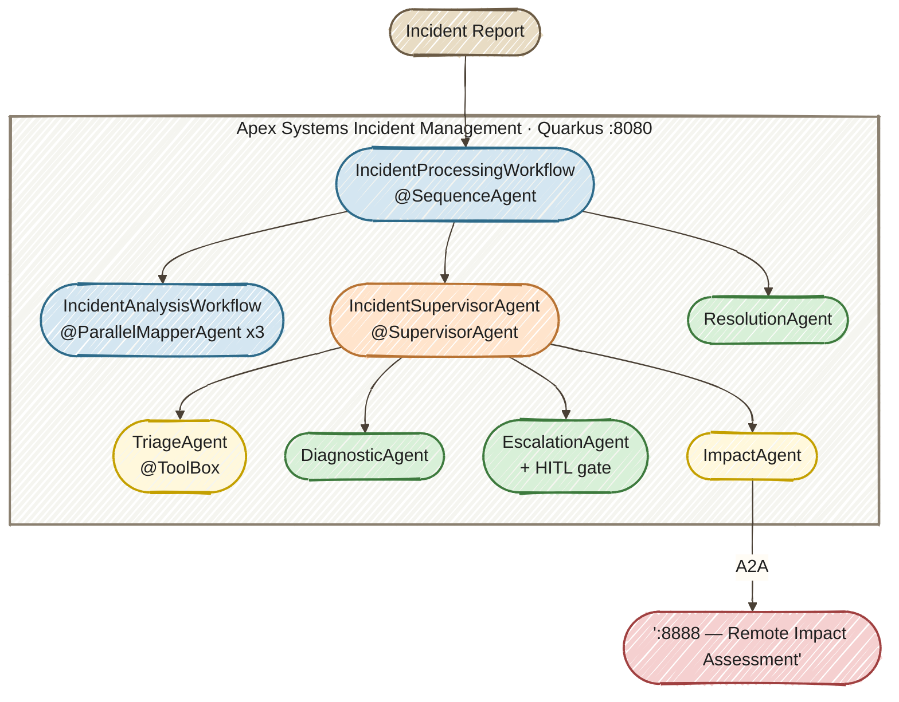

# Lab Overview

---

## The scenario: Apex Systems

**Apex Systems** is a mid-size enterprise IT services company managing infrastructure across data centers and cloud regions. The NOC (Network Operations Center) receives free-text incident reports from monitoring tools, tickets, and on-call engineers — but today those reports live in chat threads, email chains, and tribal knowledge.

Last quarter's post-mortem told the story:

- Two P1 outages (auth failure, API gateway) lasted **4+ hours because manual triage classified them as P3** — $150k combined revenue loss
- A payment-gateway incident was **routed to the networking team instead of payments**, burning 20 engineer-hours before correction
- NOC analysts cannot explain *why* an incident was routed or whether escalation was appropriate — no audit trail exists

Leadership mandate: **automate incident triage and routing with AI agents — without losing enterprise control.**

---

## Why agentic AI (not "just a chatbot")

| Chatbot | Agent |
|---------|-------|
| Answers questions | Takes actions |
| One LLM call | Multi-step reasoning + tool calls |
| No side effects | Mutates state (e.g., `IncidentStatus → TRIAGING`) |
| Stateless | Shares context via `AgenticScope` across workflow |
| Single model | Composed specialists (triage, diagnostic, impact) |

Apex Systems needs systems that **reason** over messy natural-language incident reports, **act** by calling enterprise tools, **collaborate** across specialized roles, **pause** for humans on high-stakes outcomes, and **scale** across teams via open protocols.

---

## What you will build

A production-shaped **agentic incident management platform** on Quarkus — from a single agent to a full supervisor orchestration with human oversight and distributed services.



---

## Your learning path

Each exercise adds a capability that a specific Apex Systems role needs. The persona explains the enterprise problem; in the code-along labs, you implement the Java solution that supports that role.

### Part 1 — Foundations and enterprise control

| Exercise | Persona | Problem | Pattern you learn |
|----------|---------|---------|-------------------|
| [**1 — Agent + tool**](../01-first-agent/START_HERE.md) | **Sam** — NOC analyst | Distinguish actionable reports from false alarms and record triage | `@Agent` + `@ToolBox` |
| [**2 — Policy as prompt**](../02-maintenance-agent/START_HERE.md) | **Chris** — Ops lead | Keep diagnostic guidance consistent as operating policy changes | `@SystemMessage` as policy declaration |
| [**3 — Parallel agents**](../03-parallel-workflow/START_HERE.md) | **Chris** — Ops lead | Gather severity, impact, and resolution analysis without waiting for each in turn | `@ParallelMapperAgent` + `@Output` |
| [**4 — Supervisor orchestration**](../04-supervisor/START_HERE.md) | **Priya** — IT service manager; **Riley** — SRE lead; **Sam** — NOC analyst | Coordinate business priorities, technical response, and incident handoffs | `@SupervisorAgent` within a composed workflow |
| [**5 — AI governance**](../05-ai-governance/START_HERE.md) | **Jordan** — Java platform engineer | Keep AI-assisted contributions grounded in project conventions and source | `AGENTS.md` + OpenCode CLI |
| [**6 — Human gate + tracing**](../06-hitl-observability/START_HERE.md) | **Alex** — Compliance officer | Enforce human approval for sensitive P1/P2 escalations and inspect the decision trace | `@HumanInTheLoop` + OpenTelemetry |
| [**7 — Remote agents (A2A)**](../07-a2a/START_HERE.md) | **Riley** — SRE lead | Share impact assessment through an independently operated service | A2A discovery + `@A2AClientAgent` |
| [**8 — Quality loop (bonus)**](../08-quarkus-flow/START_HERE.md) | **Jordan** — Java platform engineer | Refine post-incident reports against quality criteria within an execution limit | `AgenticServices.loopBuilder()` + Quarkus Flow |

### Part 2 — From Patterns to Production

**Six short exercises in one application:** 15 + 10 + 10 + 15 + 10 + 15 = 75 minutes, plus 15 minutes for introduction, transitions, and troubleshooting in a separate 90-minute event slot. Start `part2/lab/` once (or choose `part2/solution/` for run-and-read) and keep that folder and dev-mode terminal until Exercise 14 is complete.

Select Planning / MCP, Memory, Voting, or Events / Replay in the dashboard. Code and property edits trigger normal hot reload; PostgreSQL schema updates and idempotent seeding preserve the earlier work and records. There are no reset commands, project replacements, profile switches, or manual restarts in the core path. Preflight container images and dependencies before the event.

| Exercise | Time | Persona | Outcome |
|----------|------|---------|---------|
| [**9 — Structured Planning**](../09-plan-execute/START_HERE.md) | 15 min | Riley — SRE lead | Validated specialist plans, bounded review, and explicit recommendation readiness |
| [**10 — Required MCP Evidence**](../10-mcp-evidence/START_HERE.md) | 10 min | Riley — SRE lead | A required tool lookup before planning; fail closed when evidence is unavailable |
| [**11 — Memory Boundaries**](../11-memory-tiering/START_HERE.md) | 10 min | Sam — NOC analyst | Conversation isolation and observable eviction from the PostgreSQL-backed window |
| [**12 — Voting and Disagreement**](../12-consensus-voting/START_HERE.md) | 15 min | Priya — IT service manager | Parallel specialist ballots and deterministic majority-or-review policy |
| [**13 — Event-Driven Processing**](../13-event-driven/START_HERE.md) | 10 min | Jordan — Java platform engineer | A sequential agent workflow triggered by Kafka, with correlated outcomes |
| [**14 — Persistent Outcomes and Replay**](../14-persistent-outcomes/START_HERE.md) | 15 min | Jordan — Java platform engineer | Reuse completed work after hot reload and inspect durable, duplicate-safe outcomes |

### Part 3 — Reliable Response and Evaluation

Six short exercises provide **75 minutes of hands-on work in a 90-minute session**. Choose `part3/lab/` for code-along or `part3/solution/` for completed code, then stay in that folder throughout. The same Apex incident response moves from a runtime skill to a guarded recommendation, asynchronous approval, restart recovery, regression checks, and a measured quality experiment.

The supplied launcher starts persistent PostgreSQL before Quarkus dev mode. Edits use hot reload; **Exercise 18 deliberately restarts the JVM once** to prove a pending approval survives. No reset commands or per-exercise project switches are needed. Evaluation plumbing, the fixed dataset and scripted test server are supplied; learner tasks stay small.

| Exercise | Time | Workspace |
|----------|------|-----------|
| [15. Runtime Skills](../15-runtime-skills/START_HERE.md) | 10 min | Skills & guardrails |
| [16. Runtime Output Guardrails](../16-output-guardrails/START_HERE.md) | 10 min | Skills & guardrails |
| [17. Asynchronous Approval](../17-async-approval/START_HERE.md) | 15 min | Approval & recovery |
| [18. Restart Recovery](../18-restart-recovery/START_HERE.md) | 15 min | Approval & recovery |
| [19. Deterministic Regression Tests](../19-regression-tests/START_HERE.md) | 10 min | Tests & evaluation |
| [20. Quality Evaluation](../20-quality-evaluation/START_HERE.md) | 15 min | Tests & evaluation |

Start with [Exercise 15](../15-runtime-skills/START_HERE.md) and preflight dependency/container downloads before the event. Live evaluation uses paid model calls; automated regression tests use a local scripted model and an isolated test database.

**Exercises 1–4** are hands-on code-along — you type agent code into stub files with hot reload.  
**Exercise 5** uses OpenCode CLI to govern and validate the system you built.  
**Exercise 6** runs and reads the completed HITL solution, tests approval decisions, and inspects OpenTelemetry traces.<br>
**Exercise 7** runs a pre-built A2A solution to explore remote agent patterns.  
**Exercise 8 (bonus)** is a self-paced code-along in a standalone project — builds a programmatic quality loop with Quarkus Flow.<br>
**Exercises 9–14** are cumulative code-along labs in the same `part2/lab/` project. Each adds one focused behavior; later exercises reuse prior code and records. The completed route uses the same `part2/solution/` folder throughout. Supporting infrastructure is supplied and optional challenges are outside the core timebox.

---

**Exercises 15–20** stay in one `part3/lab/` or `part3/solution/` project. Start with `./dev.sh`; retain its dedicated PostgreSQL volume. Keep the same dev-mode session except for Exercise 18’s deliberate restart. Allocate 5 minutes for introduction, 5 for transitions and 5 for troubleshooting. Preflight downloads; larger evaluation datasets and production deployment are optional follow-up work.

## The technology stack

| Layer | Component | Role |
|-------|-----------|------|
| Runtime | Quarkus | Build-time agent validation, fast startup |
| AI extension | Quarkus LangChain4j | Declarative agents, workflows, A2A |
| Dev tooling | OpenCode CLI | SDLC partner: plan → code → test → secure |
| Context efficiency | `AGENTS.md` | Targeted AI assistant context — avoids token-bloat scans |

---

## Learning outcomes

After this lab you will be able to:

- Declare agents with `@Agent`, `@SystemMessage`, `@ToolBox` and explain what Quarkus generates at build time
- Compose multi-agent workflows: sequence, parallel, and supervisor orchestration
- Use `@SupervisorAgent` for adaptive AI routing vs hardcoded conditional logic
- Author an `AGENTS.md` to make OpenCode CLI cost-efficient on agentic projects
- Distribute agents across services with **A2A** (`@A2AClientAgent`)
- Add **human-in-the-loop** gates and read **OpenTelemetry** spans for compliance and FinOps
- Use **programmatic orchestration** (`AgenticServices.loopBuilder()`) to combine agent calls with explicit state, feedback, and bounded iteration
- Fetch required evidence through **MCP**, validate specialist plans in Java, and re-plan from reviewer feedback within an iteration limit
- Give an incident assistant **bounded, database-backed conversation memory** isolated by `@MemoryId`, and verify that evicted messages leave storage
- Run **parallel voters**, validate their ballots, and distinguish a strict majority from disagreement requiring operator review
- Connect agents to **Kafka events**, persist correlated outcomes, and replay completed requests without confusing a recommendation with verified recovery

---

## The seeded incidents

When you start the app in Exercise 1, you'll see 8 incidents in the Incident Dashboard:

| Incident # | System | Service | Priority | Initial Status |
|------------|--------|---------|----------|----------------|
| 1 | payment-gateway | checkout-api | P2 | OPEN |
| 2 | auth-service | user-login | P1 | IN_PROGRESS |
| 3 | inventory-db | stock-sync | P3 | OPEN |
| 4 | cdn-edge | static-assets | P4 | TRIAGING |
| 5 | email-service | notification-api | P2 | OPEN |
| 6 | search-engine | product-search | P3 | OPEN |
| 7 | monitoring | alerting-api | P2 | OPEN |
| 8 | api-gateway | rate-limiter | P1 | IN_PROGRESS |

You'll use these incidents throughout the exercises — processing them with different reports to trigger different agent behaviors.

---

## Patterns cheat sheet

Keep this handy as you work through the exercises:

```
Goal: single specialist agent    → @Agent + @ToolBox               (Ex 1)
Goal: policy as prompt           → @SystemMessage                  (Ex 2)
Goal: step-by-step pipeline      → @SequenceAgent                  (Ex 2–4)
Goal: concurrent work            → @ParallelMapperAgent            (Ex 3)
Goal: data-driven branching      → @ConditionalAgent               (Ex 2)
Goal: adaptive multi-agent       → @SupervisorAgent                (Ex 4)
Goal: AI governance              → AGENTS.md + OpenCode CLI        (Ex 5)
Goal: human approval             → @HumanInTheLoop                 (Ex 6)
Goal: delegate to remote agent   → A2A + @A2AClientAgent           (Ex 7)
Goal: programmatic quality loop  → AgenticServices.loopBuilder()   (Ex 8)
Goal: plan, execute, review      → ExecutionPlan + reviewed loop   (Ex 9)
Goal: required external evidence → deterministic MCP lookup        (Ex 10)
Goal: incident conversation      → @MemoryId + ChatMemoryStore     (Ex 11)
Goal: compare votes and tally    → @ParallelAgent + @Output        (Ex 12)
Goal: process incident events    → @Incoming/@Outgoing + Kafka     (Ex 13)
Goal: reuse completed requests   → persisted outcomes + replay      (Ex 14)
```
