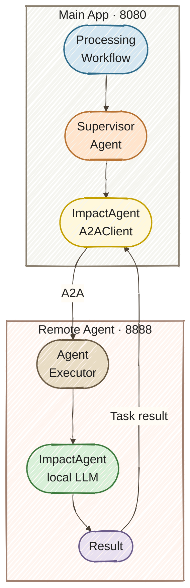

# Exercise 7 — Remote Agents (A2A)

<span class="badge badge--run-read">Run + Read</span>

**Timebox:** 10 minutes  
**Persona:** Riley — SRE team lead  
**You work in:** `solutions/07-a2a/` (run + read)

!!! tip "Reference solution"
    [`solutions/07-a2a`](https://github.com/danieloh30/agentic-ai-java-workshop/tree/main/solutions/07-a2a){:target="_blank"}

---

## Enterprise context

**Riley, Apex Systems' SRE team lead, owns an impact-assessment capability that other teams also need.** The incident supervisor uses it to inform escalation, but other applications could need the same service and SLA reasoning. Keeping the capability inside one application's JVM ties its deployment and scaling to that application, and makes reuse depend on copying or embedding the implementation.

Riley needs a service boundary that lets the SRE team operate the impact agent independently while callers discover and delegate work to it through a defined protocol. This lab runs the caller and impact agent in separate Quarkus processes, so Riley can inspect discovery, delegation, and the network boundary directly. It also makes the dependency visible: the remote agent must be available for the caller to discover it. The two local projects demonstrate that separation without requiring a production deployment platform.

## The goal

Run the two A2A applications, inspect the remote agent's AgentCard, and process an incident through the local workflow. Follow how the client discovers and invokes the remote impact agent, then explain what changes when an agent call crosses a service boundary.

## The problem

In Exercise 4, every agent ran inside a single process — same JVM, same release cycle, same crash domain. But Riley's SRE team needs `ImpactAgent` as a **remote agent**: independent repo, independent release cadence, independently scalable, and reusable by other systems beyond Apex Systems.

**Solution:** convert `ImpactAgent` into a **remote agent** using the A2A (Agent-to-Agent) protocol — the local interface stays the same, but execution happens in a separate process.

!!! info "Why run + read instead of code-along?"
    A2A requires **two separate Quarkus projects** — a remote agent server (`:8888`) and a client that discovers it via `/.well-known/agent-card.json`. Setting up cross-project dependencies, A2A agent cards, and the client-side `@A2AClientAgent` wiring in a 10-minute timebox would be mostly configuration, not learning. Running the working solution lets you focus on **how A2A works** — AgentCard discovery, task delegation, and the network boundary — rather than debugging multi-module Maven setup.

---

## Start (two terminals) (3 min)

Stop any running Quarkus process first (`Ctrl+C`). Open **two separate terminals** at the repo root and run one command block in each:

=== "Terminal 1 — impact assessment service (start first)"

    ```bash
    cd solutions/07-a2a/remote-a2a-agent
    ./mvnw quarkus:dev   # port :8888
    ```

=== "Terminal 2 — main system"

    ```bash
    cd solutions/07-a2a/multi-agent-system
    ./mvnw quarkus:dev   # port :8080
    ```

!!! warning "Start order matters"
    Wait until Terminal 1 shows `Listening on: http://localhost:8888` before starting Terminal 2. The main system discovers the remote agent via its AgentCard at startup — if the remote agent isn't ready, the A2A call will fail.

Verify the AgentCard:
```bash
curl -s http://localhost:8888/.well-known/agent-card.json | jq
```

Expected:
```json
{
  "name": "impact-agent",
  "description": "Estimates business impact and SLA cost for incident escalation decisions",
  "version": "1.0.0",
  "capabilities": {
    "streaming": true,
    "pushNotifications": false
  },
  "defaultInputModes": ["text"],
  "defaultOutputModes": ["text"],
  "skills": [
    {
      "id": "impact-assessment",
      "name": "Business impact assessment",
      "description": "Estimates business impact and SLA cost for incident escalation decisions",
      "tags": ["impact-assessment", "sla-analysis"]
    }
  ],
  "url": "http://localhost:8888/",
  "preferredTransport": "JSONRPC"
}
```

!!! tip "Agentic Dev UI"
    Open [Agentic Dev UI → Agents](http://localhost:8080/q/dev-ui/quarkus-langchain4j-agentic/agents){:target="_blank"} on the main system (:8080). In the registration table, filter for `ImpactAgent` and check its **Type**: **A2AClientAgent**. The framework proxies calls to the remote service. The generic **AI** badge in the topology or execution report describes the kind of capability; use this **Agents** table to check the A2A client registration.

    <a href="../../images/ImpactAgent.png"></a>

    Use **Topology** to inspect the structure and **Executions** after processing to inspect recorded calls. If multiple roots are available, select **`IncidentProcessingWorkflow`** in **Root Agent**; with a single root, that selector is hidden. The [Try it](#try-it-3-min) section below covers both views. Compared with Exercise 4, `ImpactAgent` is still wired into the same workflow, but execution now happens in a separate JVM on port 8888.

---

## The A2A architecture (2 min)



**A2A concepts:**

| Concept | Meaning | Analogy |
|---------|---------|---------|
| AgentCard | Capability metadata | Service contract |
| AgentExecutor | Server-side request handler | JAX-RS endpoint |
| Task | Stateful goal with input/output | Async job |
| Message | Single synchronous exchange | REST call |

---

## Try it (3 min)

Open **[http://localhost:8080](http://localhost:8080){:target="_blank"}**, click **View** on an incident that will trigger escalation (e.g., Incident **#1**, payment-gateway/checkout-api), and process with:
```text
Complete service outage, all API endpoints returning 503, cascading failures across dependent services
```

**How to confirm:** The HITL approval modal will appear — click **Escalate to Management** to continue the workflow. Check the UI for the final incident status (should reach `ESCALATED`), then inspect the run using the views below.

### Open Dev UI execution history

1. Open **[Agentic Dev UI → Executions](http://localhost:8080/q/dev-ui/quarkus-langchain4j-agentic/executions){:target="_blank"}** on the main system (:8080). If you are already on the **Agents** or **Topology** tab, click **Executions** in the top navigation.
2. If **Root Agent** is present, select **`IncidentProcessingWorkflow`**. The dropdown appears only when multiple root agents are available; if it is absent, continue with the displayed workflow.
3. Click **Refresh** if the page was open before the incident finished processing.
4. Expand the session/run and use the triangles beside parent agent names to show child calls. Inspect the **Duration**, **Model**, **Tokens**, **Input**, and **Output** columns. Hover over shortened input/output text to read its tooltip; the row triangles expand the call tree, not the text.

!!! note "An empty view does not mean a failed run"
    **Topology** displays the workflow structure; it does not display execution history. Switch to **Executions** for recorded runs. If a **Root Agent** selector is shown, choose the incident workflow rather than another root. If no selector is shown, there is no root-selection step. Process an incident and refresh after completion; do not assume that the optional screenshot-analysis agent always creates a second selectable root.

### Inspect the topology structure

Open **[Dev UI → Topology](http://localhost:8080/q/dev-ui/quarkus-langchain4j-agentic/topology){:target="_blank"}**. With a single root, the toolbar can show only **Refresh**, as in this example. The root card is labeled **`processIncident`**, with **Type `IncidentProcessingWorkflow`**. Scroll down and horizontally to follow its branches. **Toggle Edges** controls the data-flow lines; it does not switch to recorded executions.

<a href="../../images/agentic-devui-single-root-topology.png"></a>

### View the app's topology and execution report

Open **[http://localhost:8080/incident-management/report](http://localhost:8080/incident-management/report){:target="_blank"}** to view the app's own report, generated from the workflow's `agentMonitor()`. The **System Topology** view shows `processIncident` at the root, with parallel analysis, the supervisor and remote `impact-agent`, human approval, and resolution below it:

<a href="../../images/agentic-devui-topology.png"></a>

Scroll below **System Topology** to **Execution History** in the same report, then expand a session and the child-call triangles beside parent agent names:

<a href="../../images/agentic-devui-execution.png"></a>

Look for `processIncident` (SEQUENCE), `analyzeIncident` (PARALLEL, three analysis agents), and the supervisor's remote `impact-agent` call, followed by the escalation approval and resolution path. The supervisor chooses calls dynamically, so the exact rows can vary. Each row shows duration, token count, input, and output. Hover over shortened input/output text for a tooltip; there is no separate output-expansion control.

!!! tip "Read a complete input or output when its tooltip is clipped"
    Open the standalone [app report](http://localhost:8080/incident-management/report){:target="_blank"} outside the Dev UI iframe. If the hover tooltip is still clipped, use your browser's **View Page Source** on that report and search for `Estimated Impact:` or another distinctive output phrase. The generated HTML contains the full text inside a `tt-content` span, even though the table shows a shortened preview. HTML entities such as `&amp;` represent the original characters. This is a way to inspect existing report data; no extra agent invocation is needed.

!!! tip "Execution history is kept in memory"
    Process an incident before inspecting execution history. Restarting or hot-reloading the main app clears the recorded runs; process another incident if the selected workflow's history is empty afterward.

Also correlate logs across **both** terminal windows:

- **Terminal 2 (8080):** look for `impact-agent` invocation — confirms the supervisor delegated to the A2A agent
- **Terminal 1 (8888):** look for `Remote A2A ImpactAgent called` and the response (e.g., `Estimated Impact: $36,000`)
- **Terminal 2 (8080):** look for `HITL Tool: Creating escalation approval proposal` — confirms the workflow continued after the A2A round-trip

The key observation: `impact-agent` appears in the execution tree on port 8080, but it actually ran in a separate JVM on port 8888 via A2A.

---

## MCP vs A2A — when to use each (1 min)

You haven't built an MCP integration in this lab, but the distinction matters for architecture decisions:

| | MCP (Model Context Protocol) | A2A (Agent-to-Agent) |
|--|-----|-----|
| **What crosses the wire** | Tool call (function + typed args) | Agent task (goal + natural language) |
| **Who reasons** | Local LLM uses remote tool | Remote LLM reasons independently |
| **Team ownership** | Shared capability (weather, search, DB lookup) | Autonomous team agent (impact assessment, legal review) |
| **State** | Stateless per call | Optionally stateful (task lifecycle) |
| **Best for** | Shared functionality any agent can call | Delegated decision-making by another team |
| **Quarkus annotation** | `@McpToolBox("name")` | `@A2AClientAgent` |

**Rule of thumb:** If the remote service just *does something* when told exactly what to do → MCP. If it *decides something* using its own reasoning → A2A.

---

## Trade-offs (1 min)

| Factor | Local agent (Ex 4) | Remote A2A agent |
|--------|-------------|-----------------|
| **Latency** | In-process | HTTP round-trip |
| **Ownership** | Shared codebase | Independent repo + release |
| **Scaling** | Scale whole app | Scale impact service independently |
| **Failure mode** | Shared crash domain | Network partition risk |
| **Reuse** | Single app | Any A2A-compatible client |

!!! tip "When to go remote"
    Start local. Extract to A2A when the agent needs **independent scaling**, **separate ownership** (another team maintains it), or **cross-system reuse** (multiple apps call the same agent). The network hop is a real cost — don't pay it unless you get one of these benefits.

Stop both Quarkus processes (`Ctrl+C` in each terminal) before moving to Exercise 8 — or keep them running for the optional **Bonus — Multimodal log analysis** at the end of this page.

---

<div class="done-when" markdown>

## :material-check-circle: Done when

- [ ] A2A: impact assessment ran in `:8888` (confirmed in remote process logs)
- [ ] AgentCard verified via `curl`
- [ ] You can contrast MCP vs A2A in one sentence each
- [ ] You can explain when to keep an agent local vs make it remote
- [ ] *(Bonus)* `IncidentLogAnalysisAgent` wired in, and an uploaded log screenshot enriched the report

</div>

---

## Optional — Run the impact agent on WildFly (+15–20 min) { #optional-wildfly-impact-agent }

<span class="badge badge--run-read">Run + Read</span>

**Timebox:** 15–20 additional minutes

**Persona:** Riley — Apex Systems' SRE team lead

**Prerequisite:** Complete the core A2A steps above first. This extension is optional and does not change the core workshop timebox.

### Enterprise context

Riley's team owns the same business-impact capability introduced in Exercise 7. A collaborating Apex team operates Jakarta EE services on WildFly and wants to host that capability in its existing environment. The incident-management application continues to run on Quarkus. The teams agree on the A2A contract so they can choose their deployment runtimes independently.

Keep the incident, specialist role, inputs, impact result, and approval process consistent. Only the remote impact service changes runtime. The impact specialist assesses business cost and SLA risk; the main application still owns incident state, escalation approval, and resolution.

### What you will run

The Quarkus main application on **8080** delegates to an impact agent on **WildFly at 8888**. The WildFly application is a standalone WAR using LangChain4j CDI's portable extension. It shares no Panache entities or database with the caller.

The supplied HTTP adapter uses the A2A SDK to parse and serialize protocol messages. It advertises **non-streaming** operation and returns a synchronous agent message. It does not advertise streaming, background tasks, cancellation, or push notifications. This keeps the optional exercise focused on discovery and delegation across runtimes.

!!! note "What changes in the programming model?"
    The WildFly `ImpactAgent` remains a Java interface, with `@Agent`, `outputKey = "businessImpact"`, `@SystemMessage`, and `@UserMessage`. LangChain4j CDI registers it with `@RegisterSimpleAgent`; Quarkus uses its own extension integration. CDI creates the implementation in both cases. Do not implement the interface or move reasoning into the supplied servlet.

    LangChain4j CDI prompt placeholders use `{{service}}` with `@V("service")`. Keep that syntax in this module; it is not a replacement for the Quarkus examples' prompt syntax.

### 1. Prepare the local runtime (3 min)

Use **Java 25**, Python 3 for the optional offline smoke test, and a running **Podman or Docker** engine. No separate WildFly installation is needed.

On macOS or Windows, start Podman Desktop/its Podman machine, or Docker Desktop, before running the launcher. Check your chosen engine and Java:

```bash
java -version
podman info
# Or: docker info
```

Stop the Quarkus **remote** impact agent from Exercise 7 with `Ctrl+C`, freeing port **8888**. Keep the Quarkus main application if it is already running on **8080**.

Export `OPENAI_API_KEY` in the terminal that will start WildFly, as in the workshop prerequisites. The launcher passes the environment variable at runtime; it is not copied into the image.

### 2. Build and start WildFly (4 min)

From the repository root:

=== "Podman"

    ```bash
    cd solutions/07-a2a/wildfly-impact-agent
    CONTAINER_ENGINE=podman ./run.sh up
    ```

=== "Docker"

    ```bash
    cd solutions/07-a2a/wildfly-impact-agent
    CONTAINER_ENGINE=docker ./run.sh up
    ```

The launcher runs the module's tests using the existing workshop Maven wrapper, packages `target/ROOT.war`, builds an image from **`quay.io/wildfly/wildfly:42.0.0.Final-jdk25`**, and waits for AgentCard discovery to succeed. It publishes container port **8080** on host **127.0.0.1:8888**. The first build needs time to download the server image and Maven dependencies.

Verify discovery from your host terminal:

```bash
curl -fsS http://localhost:8888/.well-known/agent-card.json | jq
```

Expected output:

```json
{
  "name": "impact-agent",
  "description": "Estimates business impact and SLA cost for incident escalation decisions",
  "supportedInterfaces": [
    {
      "url": "http://localhost:8888/",
      "protocolBinding": "JSONRPC",
      "protocolVersion": "1.0"
    }
  ],
  "version": "1.0.0",
  "capabilities": {
    "streaming": false,
    "pushNotifications": false,
    "extendedAgentCard": false
  },
  "defaultInputModes": [
    "text"
  ],
  "defaultOutputModes": [
    "text"
  ],
  "skills": [
    {
      "id": "impact-assessment",
      "name": "Business impact assessment",
      "description": "Estimates business impact and SLA cost for incident escalation decisions",
      "tags": [
        "impact-assessment",
        "sla-analysis"
      ]
    }
  ]
}
```

Check the `impact-agent` name, `impact-assessment` skill, JSON-RPC interface, and the public URL `http://localhost:8888/`. The streaming capability is false (or omitted when the SDK serializes default values). That capability difference is deliberate: callers negotiate a blocking invocation.

!!! tip "A container's port and its advertised URL are different"
    WildFly listens on port 8080 **inside** its container. The caller runs on the host and reaches it through port 8888. The card therefore advertises `http://localhost:8888/`, not the container's internal address. The supplied launcher sets `PUBLIC_AGENT_URL` to match its host-port mapping.

### 3. Test the WildFly-backed flow in the SPA (5 min)

Keep WildFly running on **8888**. If the Quarkus main application is stopped, start it in a second terminal from the repository root:

```bash
cd solutions/07-a2a/multi-agent-system
./mvnw quarkus:dev
```

Wait for `Listening on: http://localhost:8080`, then open **[http://localhost:8080](http://localhost:8080){:target="_blank"}**. This is the same Apex incident-management SPA used in the core exercise. WildFly supplies the remote specialist; it does not replace the SPA or add a new dashboard.

#### A. Choose an incident that can still be processed

1. Find incident **#1**, system **payment-gateway**, service **checkout-api**. In the default sample data it is **P2 / Open**.
2. Click **View** to open its detail panel. Confirm the **System**, **Service**, **Priority**, and **Status** fields.
3. Locate the **Process Incident** form and its report text area, whose placeholder is **Enter incident report details...**.

!!! tip "Already processed #1 in the core exercise?"
    The form is available only for **Open**, **Triaging**, or **In Progress** incidents. An **Escalated** or **Resolved** incident shows a completion message instead. For a quick second run, use incident **#8**, **api-gateway / rate-limiter**, which starts at **P1 / In Progress**, and substitute its incident number throughout the checks below.

    To compare the two remote runtimes on exactly the same seeded incident, use a fresh demo session for the main A2A application. With its default Dev Services setup, restarting that application reloads its sample data and clears its recorded execution history. This affects the Exercise 7 demo; it is separate from the persistent Part 2 and Part 3 applications.

#### B. Submit the outage report once

Paste the same report used in the core exercise:

```text
Complete service outage, all API endpoints returning 503, cascading failures across dependent services
```

Leave **Choose File** empty for this test; screenshot enrichment belongs to the separate multimodal bonus. Click **Process Incident** once.

**Expected in the SPA:** the button changes to **Processing...** and is disabled while the request runs. For this severe outage, the analysis is expected to request escalation and the supervisor should invoke the remote impact specialist. Allow time for the model calls. A pending request while the workflow waits for human approval is expected; do not submit the incident a second time.

#### C. Inspect and complete the human approval

1. When the floating **Approval Needed** button appears, click it. The SPA polls for proposals every two seconds; browser notification permission is not required to use the in-page button.
2. In the approval panel, find the card for your incident number and check its system/service and priority.
3. Review **Business Impact**, **Incident Report**, and **AI Recommendation**. Confirm that the report belongs to the outage you just submitted. The impact and recommendation wording are model-generated, so do not expect a fixed dollar amount.
4. Click **Escalate to Management** to complete this walkthrough. **Resolve Incident** records a different human decision and leads to a different expected final status.

Example approval dialog for incident #1 (model-generated wording may vary):

<a href="../../images/wildfly-human-approval.png"></a>

**Expected in the SPA:** a toast starts with **Decision: ESCALATE**, and the proposal disappears. The workflow then resumes. Make the decision within five minutes, before the demo approval timeout.

!!! note "Where to verify the remote impact output"
    The approval card's **Business Impact** field displays the parallel incident-analysis summary. Use the `impact-agent` execution output in the next step to verify the separate remote WildFly assessment. Seeing a cost in the approval card alone is not proof that the A2A call ran.

#### D. Confirm the final incident outcome

Wait for the **Incident successfully processed...** toast. The detail panel closes and the incident list refreshes. Find the same row again and click **View**:

- **Status** should be **Escalated** (`ESCALATED` in the API).
- **Description** should now summarize the resulting action and the human decision.
- The processing form is replaced by **This incident has been escalated.**

These checks prove that the Quarkus application continued after the remote call and your approval. Next, verify which capability actually ran remotely.

#### E. Verify the WildFly call in the application's execution report

Open **[http://localhost:8080/incident-management/report](http://localhost:8080/incident-management/report){:target="_blank"}** in a new tab. This is the application's own report; the core exercise above includes examples of its **System Topology** and **Execution History** views.

1. Under **Execution History**, expand the latest `IncidentProcessingWorkflow` / `processIncident` run. Match its incident number and input report to your SPA submission.
2. Expand the supervisor and find the remote **`impact-agent`** / **`ImpactAgent`** execution. The supervisor can choose its sub-agents dynamically, so inspect the recorded call rather than relying on a fixed tree position.
3. Check the remote call's inputs: the system and service you selected, its numeric priority (**2** for incident #1), and the outage description.
4. Read the **Output** column on the `impact-agent` row. Look for **Estimated Impact:** and **Justification:**; the example below starts with `Estimated Impact: $8,000 Justification: ...`. Hover over the shortened text for the complete value. There is no output-expansion button. If the tooltip is clipped, use the [full-text report fallback](#view-the-apps-topology-and-execution-report) above. The caller's `ImpactAgent` maps this returned value to `outputKey = "businessImpact"`; that key need not appear as a separate field in the execution table.
5. Follow the later human-approval and resolution entries and correlate them with the SPA's final incident status.

Example remote invocation in the execution report (amount and wording vary):

<a href="../../images/wildfly-impact-agent-execution.png"></a>

The SPA has no separate WildFly badge. To establish the runtime boundary, combine this recorded A2A execution with the successful AgentCard check on **8888** and the fact that only the WildFly container is serving that port. The Quarkus remote service from the core exercise must remain stopped.

Optionally inspect **[Dev UI → Executions](http://localhost:8080/q/dev-ui/quarkus-langchain4j-agentic/executions){:target="_blank"}**: if multiple roots are available, select **IncidentProcessingWorkflow** in **Root Agent**. With a single root, no selector appears. Click **Refresh** and expand the latest run and its parent agent rows. **Topology** is a separate structure view, as shown [above](#inspect-the-topology-structure); switch to **Executions** to inspect recorded calls.

#### F. Check the server runtime and troubleshoot missing evidence

In a third terminal:

```bash
podman logs apex-wildfly-impact
# Or: docker logs apex-wildfly-impact
```

The logs should show WildFly starting, `ROOT.war` deploying, and the LangChain4j CDI portable extension registering `com.incidentmanagement.impact.ImpactAgent`. The supplied adapter does not log incident reports or model credentials.

- **No Process Incident form:** choose an unfinished incident; completed incidents cannot be submitted again from the SPA.
- **Processing... with Approval Needed visible:** open that button and complete the decision. The request is waiting for you.
- **No approval and no remote impact row:** inspect the analysis and supervisor outputs. A non-escalation path can skip the specialist and approval; it does not verify the WildFly integration. Use a fresh unfinished incident and the full outage report above.
- **Failed to process... or an error on the remote row:** repeat the AgentCard check on 8888, inspect the WildFly logs, and confirm that the container received an API key. After changing its environment, stop and start the container with `run.sh`.
- **No execution history:** process an incident after the latest main-app restart or hot reload; the monitor's history is held in memory.

**Verification is complete when:** the SPA submission, the recorded remote impact output, your human decision, and the final **Escalated** status all belong to the same run. Compare the contract and workflow continuation with the core exercise; exact LLM wording and cost estimates can differ.

### 4. Inspect the agent and discuss ownership (3 min)

Read these files in `solutions/07-a2a/wildfly-impact-agent/`:

- `ImpactAgent.java` under `src/main/java/com/incidentmanagement/impact/`: the declarative specialist and its prompts.
- `ModelConfiguration.java`: a CDI producer for the OpenAI chat model, using environment configuration.
- `ImpactProtocol.java` and `ImpactEndpoint.java`: supplied SDK/HTTP transport plumbing.
- `Containerfile`: the WAR deployment into the official WildFly image.

Discuss with your co-presenter: which team owns the impact rubric and deployment? Which application owns approval? What does the caller need to know about the remote runtime? What failure does a stopped remote server introduce?

### Offline verification for facilitators

The repeatable smoke test starts a real WildFly container and a local scripted OpenAI-compatible HTTP server, then invokes the deployed agent using LangChain4j's A2A client and the existing Quarkus caller's own dependency graph. It checks that the business prompt and all four inputs, including a multiline description, reach the model. It does not call an external LLM or require a real API key.

```bash
cd solutions/07-a2a/wildfly-impact-agent
CONTAINER_ENGINE=podman python3 smoke.py
# Or: CONTAINER_ENGINE=docker python3 smoke.py
```

It uses port **18889** by default (`WF_SMOKE_PORT` overrides it) and stops its test container on exit. Run this before delivering the optional exercise. The normal launcher runs the protocol unit tests; the container interoperability tests run when `smoke.py` supplies `-Dwildfly.url`. The `WildFly optional exercise` GitHub Actions workflow runs the same smoke test with Docker.

### Stop or return to the Quarkus remote service

```bash
cd solutions/07-a2a/wildfly-impact-agent
CONTAINER_ENGINE=podman ./run.sh down
# Or: CONTAINER_ENGINE=docker ./run.sh down
```

The stopped container is removed automatically. To repeat the original Exercise 7 setup, restart `solutions/07-a2a/remote-a2a-agent` on port 8888. Stop the main Quarkus application before starting Exercise 8.

If startup fails, inspect `./run.sh logs` with the same engine selection. A healthy empty WildFly server is insufficient: the AgentCard must return HTTP 200, confirming that the WAR deployed. If port 8888 is occupied, stop the previous remote service. An alternate `WF_PORT` is available for isolated tests, but the standard Quarkus caller expects port 8888.

<div class="done-when" markdown>

### :material-check-circle: Done when

- [ ] WildFly runs the remote impact agent in a container on host port 8888.
- [ ] The AgentCard advertises a reachable URL and the impact-assessment skill.
- [ ] The Quarkus caller receives an impact result and continues through human approval.
- [ ] Riley's persona, Apex incident, and ownership of approval remain consistent.
- [ ] You can explain which runtime-specific wiring changed and which A2A contract stayed stable.

</div>

References: [LangChain4j CDI](https://github.com/langchain4j/langchain4j-cdi), [WildFly AI guide](https://www.wildfly.org/guides/langchain-ai-chat-bot/), [official WildFly container image](https://github.com/wildfly/wildfly-container), and [A2A Java SDK](https://github.com/a2aproject/a2a-java).

---

## Bonus — Multimodal log analysis (optional, +5 min)

<span class="badge badge--code-along">Code</span>

!!! note "Optional bonus — separate from A2A"
    This task is about **multimodal input** (an agent that *reads an image*), which is
    independent of the A2A material above and adds ~5 min beyond the 10-min exercise.
    It lives here only because the complete incident-management app is in this exercise —
    skip it freely without missing anything about remote agents. You'll need **both**
    Quarkus processes still running (or restart them).

During a real incident, an SRE rarely has a clean written report — they have a **screenshot**: a log console, a Grafana panel, a stack trace. In this task you'll let the system *read that image* by wiring in a multimodal agent, then feed it a picture instead of prose.

The incident detail panel already has a **Choose File** button (`accept="image/*"`), and `IncidentLogAnalysisAgent` already exists — but it isn't wired into the workflow yet, so the upload currently has **no effect**. You'll connect it.

### How it works

`IncidentLogAnalysisAgent` is a vision agent: it takes the current `report` plus an `ImageContent`, sends both to the multimodal model (`gpt-4o`), and rewrites the report with what it sees — merged into a single description.

```java title="IncidentLogAnalysisAgent.java (already in the project)"
@SystemMessage("""
    You are a log analysis specialist... If a screenshot of logs, dashboards, or error
    messages is provided, analyze it and rewrite the incident report taking account of
    your visual observations (error patterns, stack traces, resource utilization,
    anomalous metrics, alert states, etc.)...
    """)
@UserMessage("Report: {report}")
@Agent(description = "Enriches incident reports with visual observations from log screenshots.",
        outputKey = "report", optional = true)   // (1)
String analyzeIncidentLogs(String report, @UserMessage @V("logImage") ImageContent logImage);
```

1. `outputKey = "report"` means this agent **overwrites** the `report` variable. So it must run **before** the parallel analysis reads it — i.e. it has to be the first step in the sequence.

### Your task

Open `solutions/07-a2a/multi-agent-system/src/main/java/com/incidentmanagement/agentic/workflow/IncidentProcessingWorkflow.java` and add `IncidentLogAnalysisAgent.class` as the **first** sub-agent (there's a `TODO` marking the spot):

=== "Before"

    ```java
    @SequenceAgent(outputKey = "incidentProcessingAgentResult",
            subAgents = {
                          IncidentAnalysisWorkflow.class,
                          IncidentSupervisorAgent.class,
                          EscalationProposalAgent.class,
                          HumanApprovalAgent.class,
                          ResolutionAgent.class })
    ```

=== "After"

    ```java
    @SequenceAgent(outputKey = "incidentProcessingAgentResult",
            subAgents = {
                          IncidentLogAnalysisAgent.class,   // (1) runs first, enriches "report"
                          IncidentAnalysisWorkflow.class,
                          IncidentSupervisorAgent.class,
                          EscalationProposalAgent.class,
                          HumanApprovalAgent.class,
                          ResolutionAgent.class })
    ```

    1. Add the import too: `import com.incidentmanagement.agentic.agents.IncidentLogAnalysisAgent;`

!!! info "Why first?"
    The sequence passes variables by name through the agentic scope. `logImage` enters at `processIncident(...)`; the vision agent consumes it and rewrites `report`; every downstream agent (parallel analysis, supervisor, resolution) then works from the *enriched* report. Put it anywhere later and the analysis would already have run on the raw text.

Save — Quarkus dev mode hot-reloads. (If you edited while stopped, restart Terminal 2 with `./mvnw quarkus:dev`.)

### Try it with a log screenshot

A ready-made sample screenshot ships with the project — a mock observability console for the checkout-api 503 incident (real, readable text so the model can actually parse it):

<a href="../../images/checkout-api-503-incident.png"></a>

1. Open **[http://localhost:8080](http://localhost:8080){:target="_blank"}** and click **View** on Incident **#1** (payment-gateway / checkout-api).
2. Click **Choose File** and select `solutions/07-a2a/multi-agent-system/sample-data/checkout-api-503-incident.png`.
3. Leave the report box **empty** (or add a short note) and process the incident.

**How to confirm:** In the [execution report](http://localhost:8080/incident-management/report){:target="_blank"}, the tree now starts with `analyzeIncidentLogs`, and its output `report` contains details that only appear in the image — HikariCP connection-pool exhaustion (50/50, 128 waiting), upstream `payment-processor` timeouts, and the circuit breaker in `OPEN` state. Those observations then flow into severity/impact analysis and the escalation decision.

!!! tip "Compare with and without the image"
    Process once with no file and once with the screenshot. Same incident, but the enriched run gives the downstream agents far more to reason about — that's the multimodal payoff.

!!! warning "Vision needs a multimodal model"
    This works because `application.properties` uses `gpt-4o`. A text-only model would reject the `ImageContent`. `IncidentLogAnalysisAgent` is `optional = true`, so if no image is uploaded it returns the report unchanged and the workflow proceeds normally.

When you're done, stop both Quarkus processes (`Ctrl+C` in each terminal) before moving to Exercise 8.
