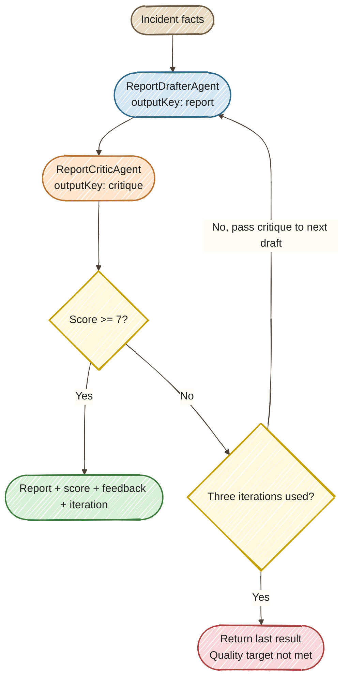

# Exercise 8 — Declarative Quality Loop (Bonus)

<span class="badge badge--code-along">Code-Along</span> <span class="badge" style="background:#6B5B8A;color:white;">Bonus</span>

**Timebox:** 15 minutes (self-paced); optional comparison is outside the core timebox.<br>
**Persona:** Jordan — Java platform engineer<br>
**You work in:** `solutions/08-quarkus-flow/lab/`<br>
**Files to edit:**

- `src/main/java/com/incidentmanagement/agentic/agents/ReportDrafterAgent.java`
- `src/main/java/com/incidentmanagement/agentic/agents/ReportCriticAgent.java`
- `src/main/java/com/incidentmanagement/agentic/workflow/IncidentReportWorkflow.java`

!!! tip "Full solution"
    The completed files are in [`solutions/08-quarkus-flow/`](https://github.com/danieloh30/agentic-ai-java-workshop/tree/main/solutions/08-quarkus-flow){:target="_blank"}. Compare individual files while keeping the same working project and dev-mode terminal.

## Enterprise context and goal

**Jordan, Apex Systems' Java platform engineer, needs incident reports that are useful after the incident bridge closes.** A first AI-generated draft may omit important details. Jordan wants a consistent review process that passes feedback into the next draft and bounds the work.

Build **draft → critique → revise** with `@LoopAgent`. Stop after a complete draft-and-critique iteration when the score reaches 7, or return the last result after three iterations. The dashboard continues to display the report, score, and iteration count through the same **Generate Report** button and REST endpoint.

The critic uses the incident record as its source of facts. Missing information must be stated explicitly, and proposed follow-up work must remain labeled as recommendations. A passing score supports report preparation; an operator still reviews the content.

## Why `@LoopAgent`?

This workflow has a fixed pair of agents and a clear stopping condition. A declarative interface makes that structure visible:

```java
@LoopAgent(name = "incident-report-quality-loop", outputKey = "reportResult",
        subAgents = {ReportDrafterAgent.class, ReportCriticAgent.class}, maxIterations = 3)
Map<String, Object> generateReport(@MemoryId String reportInvocationId,
        String system, String service, String priority, String description, String status);
```

Both agent methods are plain `@Agent` interfaces. The drafter writes `report`; the critic reads that report and writes a typed `ReportCritique` under `critique`. The next draft receives that critique through shared scope. The supplied initialization and output hooks preserve the response fields expected by the dashboard.

The programmatic builder can express the same loop. It is retained as an **optional comparison** at the end of this guide.



## Step 0 — Start the project (2 min)

Stop the previous workshop application, then start the bonus starter:

```bash
cd solutions/08-quarkus-flow/lab
export OPENAI_API_KEY=your-key
./mvnw quarkus:dev
```

!!! warning "Different starter folder"
    Use `solutions/08-quarkus-flow/lab/`, not the root `lab/` from Exercises 1–4. Keep this folder and dev-mode terminal for the exercise. Java 25 and a running Docker or Podman engine are required.

The supplied `quarkus-flow-langchain4j` dependency provides Flow-backed execution of the declarative workflow. This exercise demonstrates a bounded quality loop; persistent restart recovery is outside its scope.

## Step 1 — Define the two agents (5 min)

The starter already supplies imports, invocation IDs, and `@Agent` output keys. Replace each TODO block and placeholder method declaration with the full annotations and method below.

### ReportDrafterAgent

```java
@SystemMessage("""
            You are a post-incident report writer for an IT incident management system.
            Write a clear, structured post-incident report (PIR) covering:
            1. Incident Summary (system, service, priority, what happened)
            2. Timeline (when detected, key milestones)
            3. Root Cause Analysis
            4. Impact Assessment
            5. Resolution Steps Taken
            6. Preventive Measures / Action Items

            Use only facts present in the incident fields below. Never invent timestamps,
            metrics, root causes, resolution steps, or completed actions. If a section has no
            supporting data, write "Not available in the incident record." Clearly label any
            proposed preventive measure as a recommendation, not as an action already taken.
            Recommendations may propose specific follow-up work, measurable success criteria,
            and an owner by role (for example, the service owner) without claiming that the work
            is already approved, assigned, or completed.
            An initial critique with score 0 and empty feedback means no review has run yet.
            If you receive reviewer feedback from a previous draft, incorporate the feedback
            to improve the report's structure and accuracy, but do not treat feedback as a new
            source of incident facts. Keep the report concise (under 500 words).
            Output ONLY the report text.
            """)
    @UserMessage("""
            Write a post-incident report for:
            - System: {system}
            - Service: {service}
            - Priority: {priority}
            - Description: {description}
            - Status: {status}

            Reviewer feedback from previous draft:
            {critique}
            """)
    @Agent(description = "Drafts an incident report using authoritative facts and the previous critique.", outputKey = "report")
    String draftReport(@MemoryId String reportInvocationId, String system, String service,
                       String priority, String description,
                       String status, ReportCritique critique);
```

### ReportCriticAgent

```java
@SystemMessage("""
            You are a quality reviewer for post-incident reports (PIRs).
            Evaluate the report on these criteria:
            - Completeness: Does it cover summary, timeline, root cause, impact, resolution, and action items?
            - Clarity: Is it clear and free of unnecessary jargon?
            - Actionability: Are the preventive measures specific and assignable?
            - Accuracy: Does the report match the incident details provided?

            The incident fields in the user message are the only authoritative facts.
            A missing-data statement is complete and accurate and must not reduce the score merely
            because the incident record lacks that information. The report must not fill gaps by
            inventing timestamps, metrics, root causes, resolution steps, or completed actions.
            Clearly labeled recommendations may propose specific follow-up work, measurable success
            criteria, and an owner by role; do not treat those proposals as unsupported incident facts.
            If the report contains any unsupported factual detail, score it no higher than 6 and
            identify each unsupported claim in the feedback.

            A report qualifies for 9-10 when it covers every required section, accurately uses the
            available facts, explicitly marks unavailable facts, and provides clear, actionable
            recommendations without presenting them as completed work.

            Scoring guide:
            - 1-3: Missing major sections or factual errors
            - 4-6: Major quality gaps, vague action items, or unsupported factual details
            - 7-8: Solid report with minor improvements possible
            - 9-10: Exemplary, ready for stakeholder distribution
            """)
    @UserMessage("""
            Evaluate this post-incident report against the authoritative incident fields:
            - System: {system}
            - Service: {service}
            - Priority: {priority}
            - Description: {description}
            - Status: {status}

            --- REPORT START ---
            {report}
            --- REPORT END ---
            """)
    @Agent(description = "Reviews an incident report for accuracy, completeness, and actionable recommendations.", outputKey = "critique")
    ReportCritique critiqueReport(@MemoryId String reportInvocationId, String system, String service,
                                  String priority, String description,
                                  String status, String report);
```

The `reportInvocationId` is supplied automatically for each request, keeping unrelated report runs out of the same conversation. The first critique is initialized to score 0 with empty feedback; this means no review has run. After the critic responds, its typed result becomes input to the next draft. Feedback is guidance about the report, not a new source of incident facts.

## Step 2 — Declare the bounded loop (4 min)

Open `IncidentReportWorkflow.java`. The starter runs one draft-and-critique pair. Change its `@LoopAgent` budget from `maxIterations = 1` to `maxIterations = 3`:

```java
@LoopAgent(name = "incident-report-quality-loop", outputKey = "reportResult",
        subAgents = {ReportDrafterAgent.class, ReportCriticAgent.class}, maxIterations = 3)
```

Keep the supplied method signature. The framework runs the two listed sub-agents in that order on each iteration. `report` and `critique` are scope keys shared by those agents; `reportResult` is the composite workflow output.

Read the supplied hooks:

- `@BeforeCall` initializes the first, empty critique.
- `@Output` assembles `report`, `score`, `feedback`, and `iteration`. It counts completed critic invocations to report the number of completed iterations.
- `IncidentReportFlow` maps the incident fields to workflow arguments and supplies a fresh invocation ID. The REST endpoint and dashboard call this adapter as before.

No builder or manual specialist dispatch is required in the main implementation.

## Step 3 — Check quality after the critic (2 min)

The exit method already declares:

```java
@ExitCondition(testExitAtLoopEnd = true)
```

Keep `testExitAtLoopEnd = true`: the quality check must run after the complete draft-and-critique pair. Replace the TODO's `return true;` with:

```java
return critique.score() >= 7;
```

The framework enforces the maximum of three iterations even if this condition never becomes true. Do not change the initialization or output mapper. Save both files; the next request triggers normal hot reload.

## Step 4 — Run the demo (2 min)

1. Open [the dashboard](http://localhost:8080) and select an incident.
2. Click **Generate Report**. The endpoint remains `POST /incident-report/{incidentId}`.
3. Inspect the report, score, and iteration count. A first-pass score of 7 or higher ends the loop after one iteration.
4. A lower score causes a revision using the previous critique, up to three iterations. A run that reaches the limit may still have a score below 7; inspect and revise that report rather than treating the budget as proof of quality.

The exact score and number of revisions can vary with the model response. The supplied scripted tests cover repeatable first-pass success, feedback propagation, and exhausted iteration budgets without paid model calls.

## Done when

- [ ] The dashboard's existing **Generate Report** action returns a report, score, and iteration count.
- [ ] The two agents are declared with `@Agent` and the workflow with `@LoopAgent`.
- [ ] Reviewer feedback can reach the next draft through the typed critique.
- [ ] You can explain the score threshold, three-iteration limit, and end-of-iteration check.

## Optional comparison — Programmatic builder

This comparison is outside the 15-minute core. Keep the same project folder and dev-mode session.

The supplied `BuilderReportFlow.java` implements the same process using explicit builder configuration. The dashboard continues to use the declarative workflow; the comparison does not replace it.

```java
var workflow = AgenticServices.loopBuilder()
        .name("incident-report-builder-comparison")
        .subAgents(ClientProxy.unwrap(drafter), ClientProxy.unwrap(critic))
        .beforeCall(IncidentReportWorkflow::initialize)
        .maxIterations(3)
        .testExitAtLoopEnd(true)
        .exitCondition(IncidentReportWorkflow::qualitySatisfied)
        .output(IncidentReportWorkflow::result)
        .build();
```

The builder receives agent instances, so the comparison unwraps their Quarkus CDI client proxies. Declarative `subAgents = {...}` names the interfaces and lets the framework handle that wiring. Both versions reuse the same initialization, quality predicate, output mapping, and agent prompts.

The builder supplies incident fields through an input map; the declarative method declares those inputs as parameters. Builders are useful when constructing workflows at runtime or adding inline `agentAction(...)` Java steps. For this fixed two-agent process, the annotation keeps the main orchestration concise.

In a second terminal in this same folder, run the supplied comparison test:

```bash
./mvnw -Dtest=ReportLoopTest#optionalBuilderHasTheSameFirstPassContract test
```

Tests use an isolated PostgreSQL Dev Services database and a local scripted model; they do not use your paid API key or modify the demo database. The completed solution also tests two-iteration equivalence between the builder and annotation workflows. To run all checks, use `./mvnw test`.

Reference: [LangChain4j declarative API](https://docs.langchain4j.dev/tutorials/agents/#declarative-api){:target="_blank"} and [Quarkus Flow integration](https://docs.quarkiverse.io/quarkus-flow/dev/langchain4j.html){:target="_blank"}.
