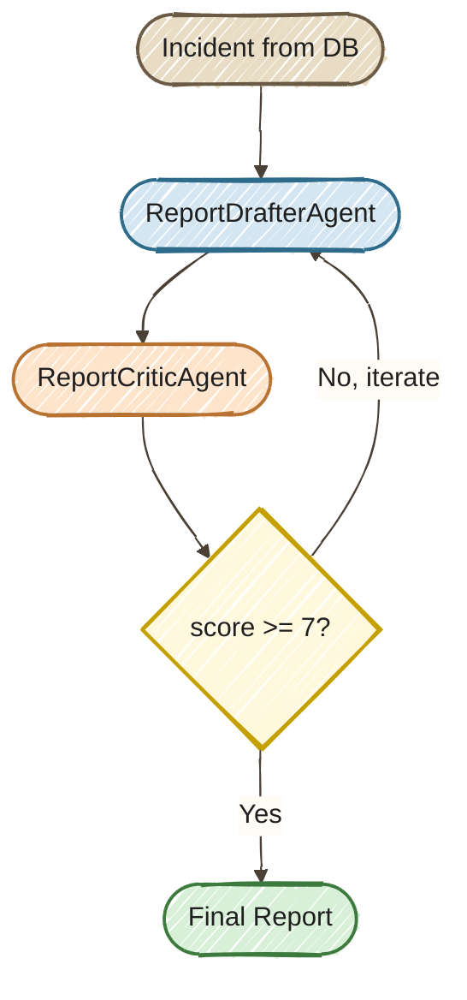

# Exercise 8 — Programmatic Orchestration: Quality Loop (Bonus)

<span class="badge badge--code-along">Code-Along</span> <span class="badge" style="background:#6B5B8A;color:white;">Bonus</span>

**Timebox:** 15 minutes (self-paced)  
**Persona:** Jordan — Java platform engineer  
**You work in:** `solutions/08-quarkus-flow/lab/`  
**Files to edit:**

- `src/.../agentic/agents/ReportDrafterAgent.java`
- `src/.../agentic/agents/ReportCriticAgent.java`
- `src/.../agentic/workflow/IncidentReportFlow.java`

!!! tip "Full solution"
    If stuck, the completed files are in [`solutions/08-quarkus-flow/`](https://github.com/danieloh30/agentic-ai-java-workshop/tree/main/solutions/08-quarkus-flow){:target="_blank"} — copy them over your TODO files and restart.

---

## Enterprise context

**Jordan, Apex Systems' Java platform engineer, needs incident reports that are useful after the incident bridge closes.** Service managers and engineers rely on those reports to understand what happened and what follow-up is needed. A first AI-generated draft can sound polished while leaving out important incident details. Having an operator repeatedly request rewrites makes report preparation slower and gives each report a different review process.

Jordan needs a workflow that drafts a report, evaluates it against explicit criteria, and feeds the critique into another draft when needed. This lab makes the score, feedback, and iteration count visible and caps the work at three iterations. Jordan can inspect both a report that passes review and a run that exhausts its budget. The automated critique supports report preparation; the score is a quality signal to inspect, rather than proof that every statement in the report is correct.

## The goal

Build a draft–critique loop that passes reviewer feedback into each revision and stops when the report scores at least 7 or reaches three iterations. Inspect the final report, score, feedback, and iteration count to understand both the quality target and the execution limit.

## Why programmatic orchestration?

In Exercises 1–4 you used **declarative annotations** — `@SequenceAgent`, `@ParallelMapperAgent`, and `@SupervisorAgent` — to compose agents. This bonus introduces another way to express orchestration: LangChain4j's programmatic builder API, backed here by [Quarkus Flow](https://docs.quarkiverse.io/quarkus-flow/dev/langchain4j.html){:target="_blank"}.

**Both declarative and programmatic APIs can express bounded quality loops.** We use the builder in this exercise to make per-iteration state updates, feedback adaptation, and Java orchestration visible alongside the agent calls:

```java
AgenticServices.loopBuilder()
    .maxIterations(3)
    .exitCondition((scope, iteration) -> scope.readState("score", 0) >= 7)
    .subAgents(draftAction, critiqueAction)
    .build();
```

---

## The scenario

After an incident is resolved, someone needs to write the **post-incident report (PIR)**. You'll build a workflow that **generates, critiques, and iteratively refines** the report until quality passes a threshold:



**The builder is a teaching and design choice.** The same draft-and-critique process could be implemented with `@LoopAgent` after refactoring the agent wiring and state adaptation.

!!! note "Why use the builder here instead of `@LoopAgent`?"
    This bonus makes three orchestration tasks explicit in Java:

    - **Feedback and iteration state** — initialize feedback for the first draft, count iterations, and pass reviewer feedback into the next draft.
    - **Result adaptation** — unpack the `ReportCritique` record into the `score` and `feedback` scope entries used by the next step and exit predicate.
    - **Result inspection** — return the final scope state so the caller can inspect the report, score, feedback, and iteration count.

    The current implementation wraps these operations and agent calls in `AgenticServices.agentAction(...)` lambdas. The annotation's `subAgents` list names types rather than accepting inline lambdas, so switching to `@LoopAgent` would require refactoring rather than replacing one annotation. A declarative alternative would wire the drafter and critic as `@Agent` interfaces with output keys and arrange their inputs and feedback through the shared scope.

    **These are not limitations of declarative workflows.** `@LoopAgent` supports an iteration limit and an `@ExitCondition`; workflow arguments can supply per-request incident data. Declarative configuration also includes `@BeforeCall` for initialization, `@AgentListenerSupplier` for invocation callbacks, and `@Output` for assembling a composite result from scope values. The [LangChain4j declarative API](https://docs.langchain4j.dev/tutorials/agents/#declarative-api){:target="_blank"} describes these options.

    **The runtime is a separate choice.** `AgenticServices.loopBuilder()` is part of LangChain4j's API. This project includes `quarkus-flow-langchain4j` to provide Flow-backed execution; the extension also supports declarative workflow annotations such as `@LoopAgent`. Choosing the builder is not a prerequisite for using Quarkus Flow. This exercise demonstrates explicit state and Java adaptation, not durable restart recovery.

---

## Step 0 — Start the project (2 min)

Stop any running Quarkus process (`Ctrl+C`), then:

!!! warning "Different `lab/` folder"
    This exercise uses `solutions/08-quarkus-flow/lab/` — **not** the root-level `lab/` folder from Exercises 1–4. Make sure you `cd` to the correct location.

```bash
cd solutions/08-quarkus-flow/lab
./mvnw quarkus:dev
```

Wait for `Listening on: http://localhost:8080`.

!!! info "New dependency"
    Check `pom.xml` — this project adds `quarkus-flow-langchain4j`, which supplies Flow-backed execution for supported LangChain4j agentic workflows. The `AgenticServices.loopBuilder()` API itself belongs to LangChain4j.

---

## Step 1 — Implement the agents (5 min)

### Step 1a — ReportDrafterAgent

Open `src/.../agentic/agents/ReportDrafterAgent.java`. Replace the placeholder `@UserMessage` and `// TODO` comment with the full annotations:

```java
    @SystemMessage("""
            You are a post-incident report writer for an IT incident management system.
            Write a clear, structured post-incident report (PIR) covering:
            1. Incident Summary (system, service, priority, what happened)
            2. Timeline (when detected, key milestones)
            3. Root Cause Analysis
            4. Impact Assessment
            5. Resolution Steps Taken
            6. Preventive Measures / Action Items

            Use only facts present in the incident fields below. Never invent timestamps,
            metrics, root causes, resolution steps, or completed actions. If a section has no
            supporting data, write "Not available in the incident record." Clearly label any
            proposed preventive measure as a recommendation, not as an action already taken.
            Recommendations may propose specific follow-up work, measurable success criteria,
            and an owner by role (for example, the service owner) without claiming that the work
            is already approved, assigned, or completed.
            If you receive reviewer feedback from a previous draft, incorporate the feedback
            to improve the report's structure and accuracy, but do not treat feedback as a new
            source of incident facts. Keep the report concise (under 500 words).
            Output ONLY the report text.
            """)
    @UserMessage("""
            Write a post-incident report for:
            - System: {system}
            - Service: {service}
            - Priority: {priority}
            - Description: {description}
            - Status: {status}

            Reviewer feedback from previous draft:
            {feedback}
            """)
```

The `@SystemMessage` defines the agent's role; the `@UserMessage` template maps each method parameter to a placeholder. The key difference from earlier exercises: the `feedback` parameter lets the loop feed critic feedback back into the next draft.

### Step 1b — ReportCriticAgent

Open `src/.../agentic/agents/ReportCriticAgent.java`. Replace the placeholder `@UserMessage` and `// TODO` comment with the full annotations:

```java
    @SystemMessage("""
            You are a quality reviewer for post-incident reports (PIRs).
            Evaluate the report on these criteria:
            - Completeness: Does it cover summary, timeline, root cause, impact, resolution, and action items?
            - Clarity: Is it clear and free of unnecessary jargon?
            - Actionability: Are the preventive measures specific and assignable?
            - Accuracy: Does the report match the incident details provided?

            The incident fields in the user message are the only authoritative facts.
            A missing-data statement is complete and accurate and must not reduce the score merely
            because the incident record lacks that information. The report must not fill gaps by
            inventing timestamps, metrics, root causes, resolution steps, or completed actions.
            Clearly labeled recommendations may propose specific follow-up work, measurable success
            criteria, and an owner by role; do not treat those proposals as unsupported incident facts.
            If the report contains any unsupported factual detail, score it no higher than 6 and
            identify each unsupported claim in the feedback.

            A report qualifies for 9-10 when it covers every required section, accurately uses the
            available facts, explicitly marks unavailable facts, and provides clear, actionable
            recommendations without presenting them as completed work.

            Scoring guide:
            - 1-3: Missing major sections or factual errors
            - 4-6: Major quality gaps, vague action items, or unsupported factual details
            - 7-8: Solid report with minor improvements possible
            - 9-10: Exemplary, ready for stakeholder distribution
            """)
    @UserMessage("""
            Evaluate this post-incident report against the authoritative incident fields:
            - System: {system}
            - Service: {service}
            - Priority: {priority}
            - Description: {description}
            - Status: {status}

            --- REPORT START ---
            {report}
            --- REPORT END ---
            """)
```

Keep the method parameters aligned with those placeholders:

```java
ReportCritique critiqueReport(String system, String service,
                              String priority, String description,
                              String status, String report);
```

Notice the return type is `ReportCritique` — a Java record with `score` and `feedback` fields. LangChain4j automatically instructs the LLM to respond in JSON and deserializes it.

---

## Step 2 — Build the loop workflow (5 min)

Open `src/.../agentic/workflow/IncidentReportFlow.java`. This is where the **programmatic orchestration** happens — no annotations, just Java code.

### Step 2a — Draft agent action

Uncomment the code block under `// TODO Exercise 08 — Step 2a` — remove the `//` prefixes so it becomes:

```java
        var draftAction = AgenticServices.agentAction(scope -> {
            String feedback = scope.readState("feedback", "No previous feedback. Write the first draft.");
            int iteration = scope.readState("iteration", 0) + 1;
            scope.writeState("iteration", iteration);
            Log.infof("Report Draft — iteration %d", iteration);

            String report = drafterAgent.draftReport(
                    incident.system, incident.service, incident.priority,
                    incident.description != null ? incident.description : "",
                    incident.status.toString(), feedback);
            scope.writeState("report", report);
        });
```

**Key concept: `AgenticScope`** — a shared state bag that passes data between agents in the loop. Each agent reads what it needs and writes its output. On the next iteration, the drafter picks up the critic's `feedback` from scope.

### Step 2b — Critique agent action

Uncomment the code block under `// TODO Exercise 08 — Step 2b`:

```java
        var critiqueAction = AgenticServices.agentAction(scope -> {
            String report = scope.readState("report", "");
            int iteration = scope.readState("iteration", 1);

            ReportCritique critique = criticAgent.critiqueReport(
                    incident.system, incident.service, incident.priority,
                    incident.description != null ? incident.description : "",
                    incident.status.toString(), report);

            scope.writeState("score", critique.score());
            scope.writeState("feedback", critique.feedback());
            Log.infof("Report Critique — iteration %d: score=%d, feedback=%s",
                    iteration, critique.score(), critique.feedback());
        });
```

### Step 2c — The loop

Uncomment the code block under `// TODO Exercise 08 — Step 2c` and **delete the `return Map.of();`** placeholder:

```java
        UntypedAgent workflow = AgenticServices.loopBuilder()
                .name("incident-report-quality-loop")
                .maxIterations(3)
                .exitCondition((scope, iteration) -> {
                    int score = scope.readState("score", 0);
                    return score >= 7;
                })
                .subAgents(draftAction, critiqueAction)
                .build();

        var result = workflow.invokeWithAgenticScope(Map.of());
        return result.agenticScope().state();
```

**This is the "aha" moment.** `loopBuilder()` creates a workflow that:

1. Runs `draftAction` then `critiqueAction` (one iteration)
2. Checks the exit condition: is `score >= 7`?
3. If yes → returns the final state (report + score + feedback)
4. If no → loops back to `draftAction` with the critic's feedback in scope
5. Stops after at most 3 iterations regardless

Compare this with `@SequenceAgent` from Exercise 4 — that runs its sub-agents exactly once. There is no way to express "retry until quality passes" with annotations alone.

---

## Step 3 — Test it (3 min)

Hot reload should have picked up your changes. Open [http://localhost:8080](http://localhost:8080){:target="_blank"} — click a **Resolved** or **Escalated** incident (e.g., #1 or #2), then click **Generate Report**.

The button triggers the quality loop. While it runs, **watch the terminal logs** — you should see the loop in action:

```
Report Draft — iteration 1
Report Critique — iteration 1: score=9, feedback=The report is solid...
Report quality loop completed for incident #1 — final score: 9
```

When the loop finishes, the dashboard shows the generated report with its **score** and **iteration count**.


!!! info "How many iterations?"
    The LLM often produces a good first draft (score >= 7), so the loop may exit after just 1 iteration. Try different incidents — some may need 2-3 rounds to reach the quality threshold.

Try several incidents to see how the loop adapts — P1 incidents with more complexity tend to need more iterations than P4s.

---

## Annotations vs programmatic builders — when to use each

| | Declarative annotations | Programmatic builders |
|--|---|---|
| **Loops** | `@LoopAgent(maxIterations = ...)` + `@ExitCondition` | `loopBuilder().maxIterations(...).exitCondition(...)` |
| **Conditionals** | `@ConditionalAgent` + `@ActivationCondition` | `conditionalBuilder()` with explicit branch configuration |
| **Steps** | Sub-agent types declared in annotations | Supplied sub-agent instances and `agentAction` lambdas |
| **Data flow** | Named inputs and scope keys; initialization and output hooks | Explicit `scope.readState/writeState` and Java adaptation |
| **Results** | `@Output` can assemble a record or map from multiple scope values | An output mapper or explicit inspection of the returned scope |
| **Best for** | Fixed workflows expressed clearly as interfaces | Runtime composition and orchestration with inline Java steps |

!!! tip "Choose the API that makes the workflow clearest"
    Use annotations when a fixed workflow reads clearly as declarative interfaces. Use builders when runtime composition or inline Java adaptation makes the orchestration easier to follow. Both approaches support bounded loops, and [Quarkus Flow supports both styles](https://docs.quarkiverse.io/quarkus-flow/dev/langchain4j.html){:target="_blank"}. Persistent restart recovery requires its own runtime and storage configuration.

---

<div class="done-when" markdown>

## :material-check-circle: Done when

- [ ] Report quality loop completed at least 1 iteration (logs show "Report Draft" and "Report Critique")
- [ ] Final report has score >= 7
- [ ] You can explain why this bonus uses the builder and how `@LoopAgent` could express an alternative
- [ ] You can describe the `AgenticScope` read/write pattern for inter-agent communication

</div>
