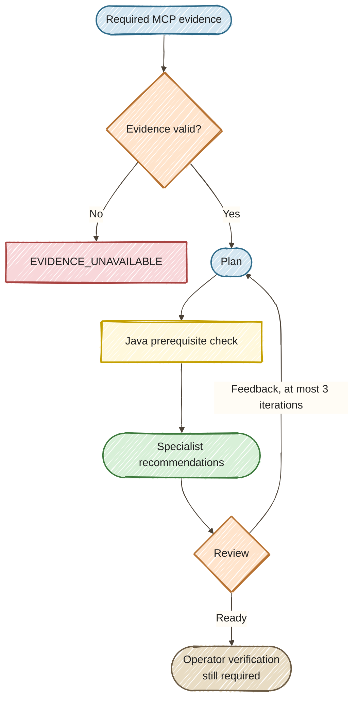

# Exercise 9 — Plan & Execute with MCP Evidence

<span class="badge badge--code-along">Code-Along</span> <span class="badge">Part 2 · 20 minutes</span>

**Persona:** Riley — SRE lead<br>
**You work in:** `solutions/09-plan-execute/lab/`<br>
**Files to edit:** `agentic/agents/PlannerAgent.java` and `agentic/workflow/PlanExecuteFlow.java`, under `src/main/java/com/incidentmanagement/`.

## Welcome to Part 2 — From Patterns to Production

This is a separate event session: **75 minutes of labs + 10 minutes of introduction/transitions + 5 minutes of troubleshooting = 90 minutes maximum**. Exercises 9–12 take **20 + 15 + 20 + 20 minutes**. Optional challenges are outside that schedule. Pre-pull dependencies and container images before the event. Each starter builds with runnable defaults; you improve behavior rather than fix an initial deployment error.

## Enterprise context and goal

Riley needs an incident-specific response plan grounded in deployment evidence. An LLM should not invent a recent deployment, execute a malformed plan, or turn a proposed mitigation into a claim of verified recovery.

Fetch required evidence through MCP, then run **Plan → Execute → Review**, bounded to three iterations. Inspect evidence, rejected plans, reviewer feedback, and the final outcome. Specialists produce recommendations; they do not modify a deployment. The dashboard therefore keeps the incident **In Progress**, even when the reviewer accepts the recommendation.



## Step 0 — Start green (2 min)

```bash
cd solutions/09-plan-execute/lab
export OPENAI_API_KEY=your-key
./mvnw quarkus:dev
```

Open [the dashboard](http://localhost:8080). The supplied fixture MCP server runs in this same application at `/mcp`; no second process is needed. The client still uses real MCP over Streamable HTTP. `EVIDENCE_MCP_URL` can point to a separately deployed compatible server.

The starter intentionally returns `EVIDENCE_UNAVAILABLE` until you connect the lookup. It boots successfully and makes no model call when required evidence is absent.

## Step 1 — Teach the planner its boundaries (6 min)

Open `PlannerAgent.java`. It is a declarative interface: `@Agent(outputKey = "plan")` returns an `ExecutionPlan` record. Keep its existing `@UserMessage`, including `{evidence}` and `{feedback}`, and replace the short `@SystemMessage` with:

```java
@SystemMessage("""
        You plan IT incident response; you do not execute production changes.
        Available specialist steps:
        DIAGNOSE: identify the likely cause using supplied facts and deployment evidence.
        MITIGATE: recommend a mitigation; requires a diagnosis.
        VERIFY: assess the recommendation and name checks an operator must perform;
                requires mitigation. Do not claim these checks have actually run.
        COMMUNICATE: write a stakeholder update; include this for P1/P2 incidents.

        Order DIAGNOSE before MITIGATE before VERIFY.
        On replanning, use feedback and prior results; schedule only unfinished work.
        Never invent deployments, metrics, tool results, or completed actions.
        Return the ordered steps and a one-sentence rationale.
        """)
```

The supplied Java `PlanValidator` checks prerequisites **before any specialist executes**. A rejected plan returns feedback to the planner; it cannot bypass the check by producing valid JSON. Prior accepted work can satisfy prerequisites on a replan.

## Step 2 — Connect required MCP evidence (5 min)

In `PlanExecuteFlow.resolve(...)`, replace the unavailable placeholder with:

```java
var evidence = evidenceClient.fetch(incident.system);
```

Read the supplied `DeploymentEvidenceClient`: it calls `getRecentDeployments` through an injected named `McpClient`, parses the tool result, and validates its service and required fields. Transport errors, tool errors, and invalid evidence all stop the run before planning.

This lookup is mandatory, so workflow code calls it explicitly. There is no extra LLM call to decide whether evidence should be fetched. `@McpToolBox` instead offers tools for a model to select. Neither approach is remote agent delegation: that was A2A in Exercise 7.

The fixture returns `workshop-release-42` and a memory-limit change for `auth-service`. These are **fixed teaching data**, not live infrastructure observations or proof of causation. The tool is an MCP server tool, using `io.quarkiverse.mcp.server.Tool`; the incident agents remain declarative `@Agent` interfaces.

## Step 3 — Inspect success and missing evidence (7 min)

1. Open incident **#2**, enter `Auth pods are OOMKilled every five minutes`, and click **Process Incident**.
2. Reopen the incident. Its saved Description contains deployment evidence, the selected plan, iteration history, and an outcome. It stays **In Progress** because no production change or recovery check was executed.
3. Inspect the iteration history: an invalid plan is rejected before execution; reviewer feedback can drive another plan. After three iterations, an unaccepted recommendation becomes `NEEDS_OPERATOR_REVIEW`. An accepted recommendation becomes `RECOMMENDATION_READY`.
4. Stop dev mode and start the supplied unavailable-evidence scenario:

    ```bash
    ./mvnw quarkus:dev -Dquarkus.profile=dev,unavailable
    ```

5. Process #2 again. Expect `EVIDENCE_UNAVAILABLE`, zero iterations, and no fabricated deployment-based diagnosis. This profile changes the MCP fixture response; the request still crosses the MCP boundary.

!!! tip "Inspect structured output without another UI run"
    The dashboard persists the summary. `POST /incident-plan/2` runs a **new** diagnostic workflow and returns `evidence`, `history`, `outcome`, and `iterations` without saving it. It does not retrieve the previous run.

## Done when

- [ ] The planner receives evidence returned by MCP and an inspectable structured plan.
- [ ] You can explain why required evidence is fetched by code rather than left to model choice.
- [ ] Missing evidence stops the run before any LLM call.
- [ ] You distinguish an accepted recommendation from a resolved production incident.

## Supplied verification and optional challenges

`./mvnw test` uses a local scripted model and the bundled MCP server, with PostgreSQL Dev Services; no paid model calls are made. The solution tests reject an invalid plan, verify evidence reaches the planner, and inspect history. The starter tests check the supplied MCP and validation infrastructure.

Outside the core timebox: compare a P4 plan, add another evidence tool, or deliberately supply `VERIFY → MITIGATE` and inspect validator feedback. Dynamic model selection and durable workflow recovery are later topics.

**Full solution:** copy the two edited files from the parent `solutions/09-plan-execute/` project if needed. Stop this application before starting [Exercise 10](../10-memory-tiering/START_HERE.md).
