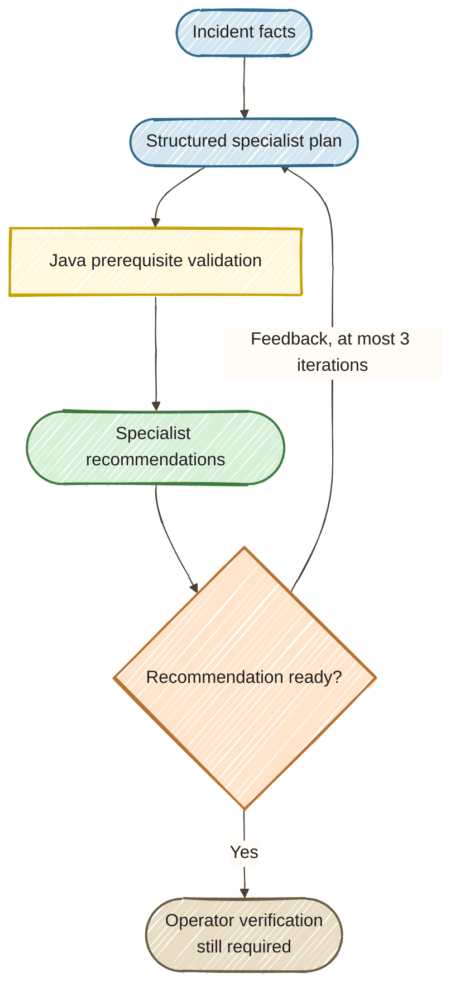

# Exercise 9 — Structured Planning

<span class="badge badge--code-along">Code-Along</span> <span class="badge">Part 2 · 15 minutes</span>

**Persona:** Riley — SRE lead<br>
**Working project for all six exercises:** `part2/lab/`<br>
**File to edit:** `src/main/java/com/incidentmanagement/agentic/agents/PlanGenerationAgent.java`.

## One application for Part 2

Part 2 is six short exercises: **9 Planning (15 min), 10 MCP evidence (10 min), 11 Memory (10 min), 12 Voting (15 min), 13 Events (10 min), and 14 Persistent outcomes/replay (15 min)**. That is **75 minutes of labs**, leaving 15 minutes for introduction, transitions, and troubleshooting in a 90-minute event slot.

Start Quarkus **once**, keep this folder and terminal for the entire part, and save edits to trigger hot reload on the next request. Select the relevant mode in the dashboard. Do not reset files, replace projects, switch Git branches, or restart dev mode between exercises. PostgreSQL and Kafka start up front; the MCP fixture server is bundled in the same application. The dev schema uses `update`, and the idempotent startup seed preserves existing records across hot reload.

Choose `part2/lab/` for code-along, or `part2/solution/` for a completed run-and-read route. Stay with that choice for all six exercises. Optional challenges and test-suite runs are outside the core timebox; preflight dependency and container downloads before the event.

## Enterprise context and goal

Riley needs different specialist work for different incidents, with an inspectable plan and a bounded review loop. Build **Plan → Execute → Review** using the incident facts already provided. Deployment evidence is explicitly **not fetched yet**; connecting it is Exercise 10.

Specialists recommend actions and production checks; they do not execute changes or observe recovery. An accepted recommendation becomes `RECOMMENDATION_READY`, while an unfinished run after three iterations becomes `NEEDS_OPERATOR_REVIEW`. The incident stays **In Progress**.

<div class="compact-diagram" markdown="1">



</div>

## Step 1 — Start once (2 min)

From the repository root:

```bash
cd part2/lab
export OPENAI_API_KEY=your-key
./mvnw quarkus:dev
```

Open [the dashboard](http://localhost:8080) and select **9–10 · Planning / MCP**. Leave this terminal running through Exercise 14. In the completed solution, the MCP lookup is already wired; inspect that code now and follow its behavior in Exercise 10.

## Step 2 — Read the plan contract (3 min)

The supplied models define a record `ExecutionPlan(List<ResolutionStep> steps, String rationale)` and four steps: `DIAGNOSE`, `MITIGATE`, `VERIFY`, `COMMUNICATE`. The supplied executor checks prerequisite ordering before running any specialist. On a replan, earlier accepted results can satisfy prerequisites.

`PlanGenerationAgent` is a declarative `@Agent(outputKey = "plan")`. Its prompt determines the work; Java checks whether the plan can be executed. Structured output alone does not guarantee a valid plan.

!!! note "Why use this executor instead of `@PlannerAgent`?"
    **These have different jobs.** `PlanGenerationAgent` is an LLM-powered `@Agent` that proposes an `ExecutionPlan`. `@PlannerAgent` is a workflow annotation that connects sub-agents to a custom Java `Planner` through `@PlannerSupplier`. A refactor to that workflow could still use `PlanGenerationAgent` to generate the plan.

    We keep the supplied executor so the 15-minute exercise makes **plan generation → Java validation → specialist dispatch → review** easy to inspect. You edit one prompt; the executor supplies the policies. The [optional architecture comparison](#optional-comparison-custom-planner-workflow) explains the alternative without adding work to the core timebox.

## Step 3 — Give the planner its rules (5 min)

Replace the short `@SystemMessage` in `PlanGenerationAgent.java` with the following. Keep its `@Agent` and existing `@UserMessage`, including the evidence and feedback placeholders.

```java
@SystemMessage("""
            You plan IT incident response; you do not execute production changes.
            Available specialist steps:
            DIAGNOSE: identify the likely cause using supplied facts and deployment evidence.
            MITIGATE: recommend a mitigation; requires a diagnosis.
            VERIFY: assess the recommendation and name checks an operator must perform;
                    requires mitigation. Do not claim these checks have actually run.
            COMMUNICATE: write a stakeholder update; include this for P1/P2 incidents.

            Order DIAGNOSE before MITIGATE before VERIFY.
            On replanning, use feedback and prior results; schedule only unfinished work.
            Never invent deployments, metrics, tool results, or completed actions.
            Return the ordered steps and a one-sentence rationale.
            """)
```

Save. Dev mode picks up the change when you next make a request. All the specialists, validator, and bounded loop are supplied.

## Step 4 — Inspect one recommendation (5 min)

1. Open incident **#2** and submit `Auth pods are OOMKilled every five minutes`.
2. Read the planning result and expand **Saved planning result** to inspect the persisted summary, selected steps, iteration feedback, and outcome.
3. The evidence section says `not_requested` and `Not fetched`. This is an honest baseline, not a fabricated tool result. The planner must work from incident facts alone.
4. Confirm the incident remains **In Progress**. A complete recommendation is not production recovery.

## Done when

- [ ] You can identify the plan, prerequisite check, specialist results, and review outcome.
- [ ] You can explain how feedback and the three-iteration budget bound replanning.
- [ ] You can distinguish `PlanGenerationAgent` from the framework’s `@PlannerAgent` workflow annotation.
- [ ] You distinguish incident facts from evidence that has not been retrieved.

## Optional comparison — Custom planner workflow

This is an architectural comparison outside the 15-minute core. Keep the existing application and dev-mode session; no code changes are required. The alternative below is a design outline, not a supplied runnable implementation.

### Plan generation and workflow planning are separate responsibilities

`PlanGenerationAgent` answers **“What specialist work should this incident need?”** with structured data. The executor answers **“Which proposed steps may run, with which inputs, and what happens after review?”** A framework `Planner` can take over that orchestration role. It does not remove the need to generate or validate the incident plan.

| Design question | Current `PlanGenerationAgent` + executor | Alternative `@PlannerAgent` workflow |
|-----------------|-----------------------------------------|-------------------------------------|
| Who proposes the specialist steps? | `PlanGenerationAgent` returns `ExecutionPlan`. | Keep `PlanGenerationAgent` as a sub-agent for the same LLM-generated plan. |
| Where is orchestration defined? | `PlanExecuteFlow` assembles plan, execute, and review actions in a bounded loop. | A workflow interface declares sub-agents; `@PlannerSupplier` supplies the custom Java `Planner` that chooses the next action. |
| Who enforces prerequisites? | `PlanValidator` rejects invalid ordering before specialist dispatch. | Reuse that validation before the custom planner schedules specialists. |
| Who carries results and reviewer feedback? | Explicit scope updates carry specialist results and feedback into replanning. | The custom planner and agent input/output contracts must arrange equivalent scope state. |
| Who bounds replanning? | The supplied loop allows at most three iterations and stops when the recommendation is ready. | Custom orchestration must preserve an equivalent review policy and iteration budget; `@PlannerAgent` alone does not supply those domain rules. |
| Where does required MCP evidence fit? | Exercise 10 wires the supplied evidence lookup before planning and blocks unusable evidence. | Preserve that gate before the plan-generation sub-agent is scheduled. |
| What does the participant implement? | One agent prompt; the executor is supplied. | Building the alternative also requires a custom `Planner`, workflow wiring, and behavioral checks. |
| When is it useful? | Teaching structured planning and deterministic checks in a short lab. | Teaching custom framework orchestration or integrating a reusable scheduling policy. |

### Where the framework pieces would fit

A refactor would introduce three pieces:

1. A **workflow interface** with a method annotated `@PlannerAgent`, naming `PlanGenerationAgent`, the specialist agents, and `ResolutionReviewAgent` as sub-agents.
2. A **static `@PlannerSupplier` method** in that interface returning a custom Java `Planner`. The planner is orchestration infrastructure; the LLM agents remain plain `@Agent` interfaces.
3. The **custom planner's action-selection logic**, using the framework's `firstAction(...)` / `nextAction(...)` lifecycle to schedule plan generation, validate the result, dispatch the requested specialists, and schedule review. It would carry forward accepted results, invalidate dependent results when earlier work changes, feed review feedback into another plan, and enforce the three-iteration limit.

The existing REST adapter could then invoke that workflow and retain the dashboard response fields and history. The evidence gate, scope inputs/outputs, and result mapping would need deliberate wiring; placing `@PlannerAgent` on `PlanGenerationAgent` would not perform this refactor.

!!! note "Why this differs from the Ex8 refactor"
    **Ex8 has a fixed pair of steps:** draft, critique, then repeat. `@LoopAgent` directly expresses that shape and its bounded repetition. Ex9 chooses specialist work from an LLM-generated plan and applies domain-specific prerequisite and review policies. `@PlannerAgent` provides a place to integrate those policies through a custom planner; it does not make the policies disappear.

    The choice here is about the learning goal. Keep the current executor when teaching inspectable plans and deterministic validation. Explore the custom planner when teaching how to build a new orchestration pattern. Both approaches should retain the distinction between a ready recommendation and verified production recovery.

Before treating a custom planner as equivalent, verify that invalid plans invoke no specialists, changed diagnoses invalidate dependent results, reviewer feedback drives replanning, and the third failed review returns `NEEDS_OPERATOR_REVIEW`. After Exercise 10, also verify that unusable required evidence stops the run before plan generation. These behaviors define equivalence more meaningfully than a shorter workflow declaration.

Reference: [LangChain4j custom planners and declarative API](https://docs.langchain4j.dev/tutorials/agents/){:target="_blank"}. The `Planner`, `@PlannerAgent`, and `@PlannerSupplier` roles above also match this workshop's pinned LangChain4j API.

---

**Keep the same application running.** Continue to [Exercise 10 — Required MCP Evidence](../10-mcp-evidence/START_HERE.md); there is no reset or folder change. If stuck, compare only `PlanGenerationAgent.java` with its counterpart in `part2/solution/`.
