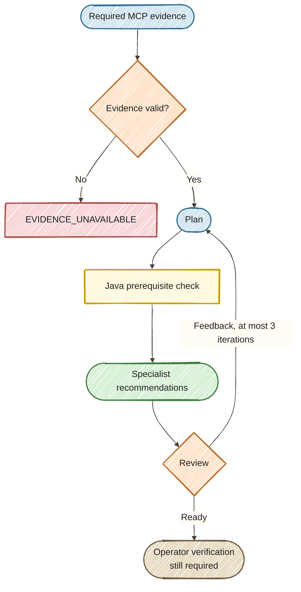

# Exercise 10 — Required MCP Evidence

<span class="badge badge--code-along">Code-Along</span> <span class="badge">Part 2 · 10 minutes</span>

**Persona:** Riley — SRE lead<br>
**Continue in:** the running `part2/lab/` application, **Planning / MCP** mode.<br>
**Files to edit:** `src/main/java/com/incidentmanagement/agentic/workflow/PlanExecuteFlow.java` and `src/main/resources/application.properties`.

## Enterprise context and goal

Riley, the SRE lead, needs deployment context before recommending how to handle the authentication incident. An incident report alone cannot establish what changed in the latest release, and a failed lookup must not become an invented deployment history. Riley wants the team to see which evidence informed the plan and when the required evidence could not be obtained.

Extend the plan you just built with a required deployment lookup. Fetch evidence through real MCP over Streamable HTTP, validate its service and fields, and stop before planning if it is unavailable. Keep all earlier edits and results. The supplied workshop evidence informs recommendations; it does not prove a cause or confirm production recovery.

<div class="compact-diagram" markdown="1">



</div>

!!! tip "Choose the route for your working project"
    **`part2/lab/`:** make the one-line change in Step 1, then run Steps 2–3. **`part2/solution/`:** inspect the already-connected lookup in Step 1, then run the same Steps 2–3. In both projects, Step 2 should show available evidence; Step 3 should stop planning when evidence is unavailable and resume after you restore it.

## Step 1 — Connect the lookup (3 min)

The MCP client and fixture server are already supplied. Your change decides **when evidence becomes mandatory**, rather than asking the model whether it wants to fetch it.

In `PlanExecuteFlow.resolve(...)`, replace the explicit `not_requested` baseline with:

```java
var evidence = evidenceClient.fetch(incident.system);
```

Save the file. In the completed `part2/solution/` application this call is already connected; inspect it and continue to Step 2.

Read the supplied `DeploymentEvidenceClient.fetch(...)` to follow the boundary:

1. **Discover:** `client.listTools()` obtains the tool metadata and checks that `getRecentDeployments` is advertised.
2. **Call:** `client.executeTool(...)` sends that tool name and the incident's system as the `service` argument over MCP Streamable HTTP to the bundled `/mcp` endpoint.
3. **Validate:** decode the returned data as `DeploymentEvidence`; require the requested service, an `available` status, and nonblank deployment and observation fields.
4. **Gate:** only usable evidence reaches the planner. Discovery, transport, tool, or validation failure produces `EVIDENCE_UNAVAILABLE`; the workflow stops before any planning-model call.

The fixture server lives in the same application to simplify event setup, but the lookup still crosses the MCP HTTP boundary. It supplies data for our agents, while A2A in Exercise 7 delegated work to another agent.

!!! tip "Keep dev mode running; submit a new request"
    The visible recommendation is a **saved result from the previous run**. Saving code does not rerun it. Do not restart dev mode or press `s` for this transition. Follow Step 2 to submit the report again; the next request triggers hot reload and a new MCP-backed planning run.

## Step 2 — Compare with the baseline (3 min)

1. Open [the dashboard](http://localhost:8080) in your running Part 2 application. At the top of the page, open the **Workflow** dropdown and choose **Planning / MCP (Ex9–10)**.
2. Open incident **#2** — **auth-service / user-login**. In the **Generate recommendation** report field, paste:

    ```text
    Auth pods are OOMKilled every five minutes
    ```

3. Click **Generate recommendation** and wait for the planning run to finish. Reopen incident **#2** if its detail panel closes.
4. In **Planning result**, check the **Deployment evidence** card. It should show `available`, release `workshop-release-42`, and the fixture observation about a reduced memory limit.
5. Expand **Diagnosis** under **Specialist recommendations** and the rounds under **Review timeline**. Inspect how the diagnosis and plan use the deployment evidence.

This is the same operator report used in Exercise 9. In the **starter route**, the earlier evidence-free baseline showed **Not fetched** (`not_requested`); this new run should include MCP evidence. In the **completed solution**, the lookup was already wired during Exercise 9, so evidence may already have been available. Do not expect a no-lookup baseline there: verify the available evidence now, then test its failure behavior in Step 3. If you skipped Exercise 9, the checks above still apply.

These are **fixed workshop data**, not live infrastructure observations or proof of causation. You are making a new planning run; earlier runs are not replayed automatically. `/incident-plan/2` also starts a new diagnostic run if called with POST.

## Step 3 — Make evidence unavailable without restarting (4 min)

In `application.properties`, change:

```properties
workshop.evidence.scenario=unavailable
```

Leave dev mode running. Save, open incident **#2**, paste the report from Step 2 into **Generate recommendation**, and submit it again. Expect:

- **Evidence unavailable** in the outcome card and `unavailable` in the evidence card.
- No review rounds or specialist recommendations for this run. The original saved result reports `EVIDENCE_UNAVAILABLE`; the run performs zero planning iterations.
- No planning-model call: the MCP request returned fixture data, but those data did not meet the evidence requirement. This is a controlled unavailable-evidence scenario, not a simulated network outage.

Restore the property:

```properties
workshop.evidence.scenario=available
```

Save and submit the same report once more. Confirm that the release and planning results return. Each submission starts a new run; existing incident records remain available throughout hot reload.

## Done when

- [ ] An available-evidence run shows `workshop-release-42` and specialist recommendations. In the starter, this replaces the no-lookup baseline.
- [ ] Unavailable evidence stopped the run before any model call.
- [ ] You restored `available` by editing the property while keeping dev mode running.

## Optional verification — Run the supplied tests

The dashboard checks in Steps 2–3 are the core verification for **both** routes. For repeatable automated checks, open a **second terminal in the same project folder** (`part2/lab/` or `part2/solution/`) after restoring `workshop.evidence.scenario=available`. Keep your dev-mode terminal running.

```bash
./mvnw -Dtest=DeploymentEvidenceClientTest,PlanExecuteTest,EvidenceUnavailableTest test
```

These tests use local MCP fixtures and a local scripted model, without paid model calls. The unavailable-evidence test selects its own scenario through a test profile; you do not need to edit the property again. Maven runs a separate test application; it does not submit reports through your open dashboard.

Expected result in the **completed solution**:

```text
Tests run: 10, Failures: 0, Errors: 0, Skipped: 0
BUILD SUCCESS
```

The **starter** reports **6 tests** with zero failures and errors. It has fewer planning-workflow checks because its Exercise 9–10 edits are learner tasks; both routes include the same three discovery-boundary checks and the unavailable-evidence check.

The checks cover discovering before calling, repeated successful lookups, failed discovery, an absent required tool, and unavailable evidence. The completed solution additionally verifies evidence reaching the planner, invalid-plan handling, and stopping before model calls when evidence is unusable. Automated checks complement the dashboard run; they do not prove a live model will produce identical wording.

This test run is outside the 10-minute core timebox. Continue with the same project and dev-mode session when it finishes.

## Optional insight — Why this MCP API?

This comparison is outside the 10-minute core; no additional code changes are required.

| Approach | Who selects the tool? | Where it fits |
|----------|-----------------------|---------------|
| Injected `McpClient` + `executeTool(...)` — this lab | Workflow Java selects the named tool. | An explicit required lookup with decoding, validation, and failure handling in one supplied adapter. |
| `@McpClientAgent` | A non-AI agent binds one named MCP tool; orchestration decides when to invoke that node. | Representing a tool call as a reusable workflow step with declared inputs and an output key. |
| `@McpToolBox` | The model can select from the attached MCP tools. | Agent tasks where tool use is driven by the model; required preconditions still need enforcement in workflow code. |

!!! note "Why not use `@McpClientAgent` here?"
    **It is a valid alternative for a deterministic lookup.** `@McpClientAgent` wraps a single MCP tool as a **non-AI agent**; it is different from exposing tools to an LLM with `@McpToolBox`. Required evidence is therefore not, by itself, a reason to reject `@McpClientAgent`.

    We keep the supplied `DeploymentEvidenceClient` because this exercise focuses on the evidence boundary: discover the tool, call it, decode the result, validate its service and fields, and stop safely on failure. The learner connects that policy with one line in `PlanExecuteFlow`.

    A declarative alternative would bind `getRecentDeployments` with `@McpClientAgent`, supply its MCP client through `@McpClientSupplier`, and place that node before planning. It would still need equivalent decoding, validation, and unavailable-evidence handling. That is an architectural refactor, not a replacement annotation on the current CDI adapter. The annotation does not itself prove that the evidence is valid.

### Understanding the tool-discovery warning

If an older checkout logs **“Executing tool 'getRecentDeployments' before the tool list is known”**, the direct execution happened before the client discovered tool metadata. That metadata is also needed when a server declares `x-mcp-header` parameters, whose values can be sent as `Mcp-Param` headers. The warning alone does not mean the tool failed; inspect the returned evidence and outcome.

The supplied adapter now calls `listTools()` and confirms the required tool is advertised **before** `executeTool(...)`. Discovery failure or an absent tool follows the same unavailable-evidence path. This addresses the call order rather than hiding the warning with a logging setting. Tool discovery and data validation have different jobs: discovering a tool does not make its returned evidence trustworthy.

References: [Quarkus programmatic MCP access](https://docs.quarkiverse.io/quarkus-langchain4j/dev/mcp.html#_programmatic_access_to_mcp_clients) and [LangChain4j `@McpClientAgent`](https://docs.langchain4j.dev/apidocs/dev/langchain4j/agentic/declarative/McpClientAgent.html).

**Keep the same folder and terminal.** In the dashboard’s **Workflow** dropdown, choose **Memory (Ex11)** for [Exercise 11 — Memory Boundaries](../11-memory-tiering/START_HERE.md). If stuck, compare `PlanExecuteFlow.java` with the shared solution; do not overwrite the whole project.
