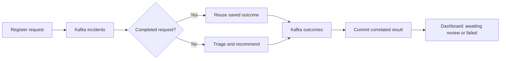

# Exercise 12 — Reliable Event-Driven Agents

<span class="badge badge--code-along">Code-Along</span> <span class="badge">Part 2 · 20 minutes</span>

**Persona:** Jordan — Java platform engineer<br>
**You work in:** `solutions/12-event-driven/lab/`<br>
**File to edit:** `src/main/java/com/incidentmanagement/messaging/IncidentEventConsumer.java`.

## Enterprise context and goal

Jordan needs alert ingestion to complete independently of model latency, and processing outcomes to survive a browser refresh. Duplicate delivery must not create another saved result, and a generated recommendation must not mark a production incident resolved.

Wire the supplied sequential agents into the Kafka consumer, inspect the saved outcome, and replay the same request. Kafka and PostgreSQL run through Dev Services. Correlation, durable result storage, duplicate protection, and the dashboard are supplied.

The path is **publish → Kafka → triage/recommendation agents → Kafka → transactional result store**. Processing status is separate from incident status:

- `PUBLISHED`: the request is registered; publication/processing is pending.
- `AWAITING_REVIEW`: a recommendation was generated, with no claim of executed remediation.
- `FAILED`: publication or agent processing failed and requires operator attention.

The dashboard leaves an active incident **In Progress**. Only an actual recovery/approval process should close it.



## Step 0 — Start green (3 min)

Stop Exercise 11. From the repository root:

```bash
cd solutions/12-event-driven/lab
export OPENAI_API_KEY=your-key
./mvnw quarkus:dev
```

Docker or Podman must already be running. Open [the dashboard](http://localhost:8080). The starter builds with a consumer that returns an explicit `FAILED` outcome until you connect the agents. Complete Step 1 **before publishing**: the first terminal result is retained, so replay will not replace a starter failure.

## Step 1 — Connect the stream processor (6 min)

Open `IncidentEventConsumer.java`. Read the supplied annotations:

```java
@Incoming("incidents-in")
@Outgoing("resolutions-out")
@Blocking
```

The incoming payload is an `IncidentEvent` with a unique `requestId` and an `incidentId`. The consumer first checks the durable store: completed replays reuse the saved result without another model call.

Inside `try`, replace the starter's explicit failure return with:

```java
return workflow.process(event);
```

The supplied `IncidentResolutionWorkflow` is a declarative `@SequenceAgent`: `TriageAgent` writes `triage`, `ResolutionAgent` reads it and writes `resolution`, and `@Output` builds a correlated `ResolutionEvent` with `AWAITING_REVIEW`.

`@Blocking` makes worker-thread execution explicit for synchronous model calls. The publisher returns without waiting for the agent pipeline; this does not make the LLM calls themselves nonblocking. Exceptions become a visible `FAILED` outcome rather than an invented recommendation.

## Step 2 — Follow acceptance through completion (6 min)

1. Open incident **#2**, enter `Auth pods are OOMKilled every five minutes`, and click **Process Incident**.
2. The submission response contains a request ID. It confirms submission, not successful processing.
3. Close and reopen the incident after processing. The **Recommendation / Processing Outcome** panel reads the latest persisted request. It initially shows pending processing, then `AWAITING_REVIEW` or `FAILED`.
4. Refresh the dashboard and reopen #2. The server returns the saved processing result; it is not held only in browser memory. The incident remains **In Progress**.
5. Open [#2's result](http://localhost:8080/incident-events/resolutions/2). Copy its `requestId` for Step 3.

The store writes one `ProcessingRequest` row per request. Its transaction commits before the sink returns and messaging acknowledges the outcome. Database commit failures therefore do not become successful acknowledgements. The latest-request query ignores late results from older requests when choosing what the UI displays.

## Step 3 — Replay without another model call (5 min)

Keep Quarkus running. Replace `REQUEST_ID` below with the completed request's actual ID:

```bash
curl -sS -X POST http://localhost:8080/incident-events/replay/REQUEST_ID
```

Wait for the log `Reusing completed request for incident #2`, then reload [the result](http://localhost:8080/incident-events/resolutions/2). The request ID and saved recommendation are unchanged. In the Dev UI database view, `processingrequest` still contains one row for that request.

A replay reuses the original input and request ID; clicking **Process Incident** again creates a **new** request. To retry a failed run with changed conditions, submit a new request. The first terminal outcome for an existing request is retained.

!!! note "What this lab guarantees"
    Completed replays reuse results, and duplicate outcomes are persisted idempotently. This is **not exactly-once model execution**: a crash before result persistence can lead to another model call. Registration and Kafka publication also have a crash gap; an outbox is a later extension. Records survive browser refresh; application restart recovery additionally needs retained database/broker configuration. This exercise does not checkpoint a waiting workflow.

## Done when

- [ ] You wired the sequence into the consumer and distinguished submission from completion.
- [ ] The recommendation remains available after browser refresh while the incident stays In Progress.
- [ ] Replaying a completed request reuses its result and does not create another database row.
- [ ] You can distinguish duplicate-safe result storage from exactly-once execution or durable workflow recovery.

## Supplied verification and optional challenges

`./mvnw test` exercises correlation, persistence, duplicate outcomes, completed replay, latest-request selection, and the sequence with scripted model replies. PostgreSQL and Kafka Dev Services are required; no paid model calls are made.

Outside the core timebox: publish two distinct requests and deliver their results out of order, add an outbox, or design retry/dead-letter policy. Durable approval/restart recovery and evaluation are follow-on topics.

**Full solution:** copy `IncidentEventConsumer.java` from the parent project. This completes the **75-minute Part 2 core**, leaving 15 minutes for introduction, transitions, and troubleshooting within the 90-minute event slot.
