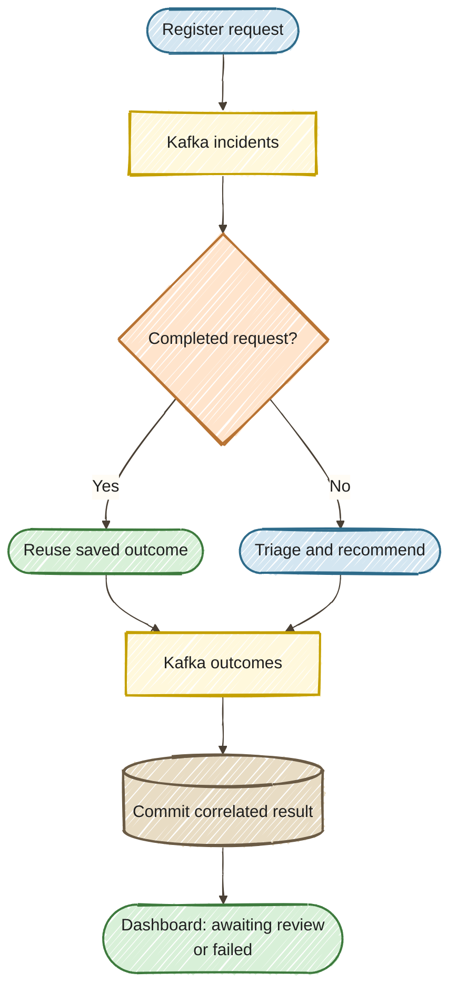

# Exercise 13 — Event-Driven Processing

<span class="badge badge--code-along">Code-Along</span> <span class="badge">Part 2 · 10 minutes</span>

**Persona:** Jordan — Java platform engineer<br>
**Continue in:** the running `part2/lab/` application.<br>
**File to edit:** `src/main/java/com/incidentmanagement/messaging/IncidentEventConsumer.java`.

## Enterprise context and goal

Jordan, the Java platform engineer, needs monitoring systems to submit incident alerts without waiting for model calls to finish. Operators still need to find the eventual result for the right request and distinguish work that was submitted from a recommendation that is ready for review. A quick submission response must not imply that the incident has been resolved.

Accept an alert without making its producer wait for the model. Connect the supplied agent sequence between two Kafka topics and follow its correlated outcome to the dashboard. Kafka and PostgreSQL have been running since Exercise 9; no dependency, folder, profile, or terminal change is needed.

<div class="compact-diagram" markdown="1">



</div>

## Step 1 — Select Events (1 min)

Choose **13–14 · Events / Replay** in the dashboard. Complete the consumer edit below before submitting. The starter returns an explicit failure until it is connected; a terminal outcome is retained, so submitting a new request is how you try again after correcting the starter.

## Step 2 — Read the supplied sequence (3 min)

Open `IncidentResolutionWorkflow.java`. Its `@SequenceAgent` runs `TriageAgent` then `ResolutionAgent`. The latter reads `triage` from shared scope; `@Output` builds a `ResolutionEvent` containing the original request ID, incident ID, and `AWAITING_REVIEW`.

The event pipeline is separate from the planning loop: choosing Events changes the entry path, without deleting or undoing any work from prior exercises.

## Step 3 — Connect the consumer (3 min)

In `IncidentEventConsumer.process(...)`, keep `@Incoming`, `@Outgoing`, and `@Blocking`. Inside `try`, replace the starter's explicit failure return with:

```java
return workflow.process(event);
```

Save and submit a request to trigger hot reload. The publisher returns before the synchronous model work finishes on a worker thread. Exceptions produce a visible `FAILED` outcome rather than an invented recommendation.

## Step 4 — Follow the handoff (3 min)

1. Open incident **#2**, enter `Auth pods are OOMKilled every five minutes`, and click **Process Incident**.
2. Read the submission acknowledgement and request ID. Submission is not completion.
3. Close and reopen #2 after processing. Its result changes from pending to `AWAITING_REVIEW` or `FAILED`. The incident remains In Progress.
4. Leave this request in place. Its persisted outcome is the starting point for Exercise 14.

## Done when

- [ ] You connected the sequential agents to the Kafka consumer.
- [ ] You distinguished request acceptance, processing outcome, and incident status.
- [ ] A request ID correlates the recommendation to the submitted work.

**Keep the same folder, terminal, and request.** Continue directly to [Exercise 14 — Persistent Outcomes and Replay](../14-persistent-outcomes/START_HERE.md).
