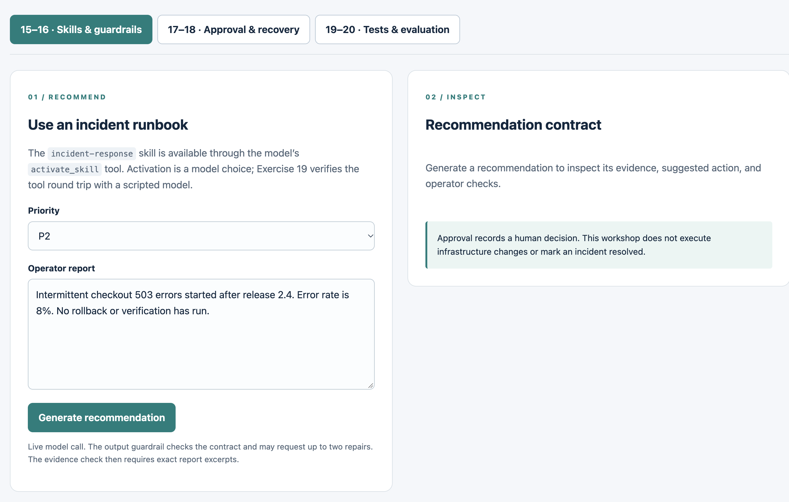

# Exercise 15 — Runtime Skills

<span class="badge badge--code-along">Code-Along</span> <span class="badge">Part 3 · 10 minutes</span>

**Persona:** Riley — SRE lead<br>
**Continue in:** `part3/lab/` (or the completed `part3/solution/`), **Skills & guardrails** workspace.<br>
**Files to edit:**

- `src/main/resources/skills/incident-response/SKILL.md`

## Enterprise context and goal

Riley, the SRE lead, needs consistent response guidance for checkout errors and authentication failures without making the main agent prompt a growing collection of runbooks. Operators need recommendations that reflect the incident priority and name the checks they must perform, while keeping proposed work distinct from actions already completed. Riley wants that domain guidance maintained as a reusable runtime skill.

Extend the supplied incident-response skill with escalation rules and service-specific operator checks, then compare checkout and authentication recommendations in the same running application. A runtime skill advertises a name and description, then provides its instructions when the model calls `activate_skill`. Java approval and evidence checks remain separate from that model-selected guidance.

This is application guidance consumed by the running agent. Part 1's `AGENTS.md` governs your coding assistant. MCP supplies tools/data; A2A delegates to a remote agent. Skills provide reusable instructions.

## Step 1 — Start the shared project (2 min)

From the repository root, choose the starter **once**:

```bash
cd part3/lab
export OPENAI_API_KEY=your-key
./dev.sh
```

Use `part3/solution` instead for the completed run-and-read route. Java 25 and a running Docker or Podman engine are required. Open [http://localhost:8080](http://localhost:8080). Stay in this folder for Exercises 15–20. Stop any previous workshop app using port 8080 first.

The supplied launcher creates a dedicated PostgreSQL container and named volume. Later code/resource edits use hot reload. Pre-download dependencies and the image with `./dev.sh --prepare` before the event; downloads are outside the core timebox. No real API key is needed for that preparation.

!!! note "Why `./dev.sh` instead of `quarkus dev`?"
    The launcher creates or restarts PostgreSQL with a persistent named volume, waits for it to be ready, and then runs `./mvnw quarkus:dev`. This preserves records across application restarts, which Exercise 18 uses to demonstrate recovery. Part 3 disables automatic database Dev Services in dev mode, so starting Quarkus directly does not create the required database.

## Step 2 — Add domain guidance (4 min)

Open the skill file. Keep its YAML `name` and `description`. Extend the body with:

```markdown
For P1 or a report of complete authentication failure, recommend ESCALATE to the on-call team.
For other reports recommend INVESTIGATE unless the facts explicitly justify escalation.
For checkout 503 errors, propose checking deployment timing and comparing error rate with baseline.
For authentication failures, propose checking identity provider health and a synthetic login.
Name checks for the operator to perform; never say these checks already passed.
```

Save. The supplied `quarkus.live-reload.watched-resources` setting watches this skill. Wait about three seconds for the change scanner, then make a new request to trigger reload; keep the terminal running.

Open `src/main/java/com/incidentmanagement/agents/ResponseAgent.java` in your chosen `part3/lab/` or `part3/solution/` folder, then inspect the supplied method:

```java
@Skills("incident-response")
@OutputGuardrails(value = ResponseGuardrail.class, maxRetries = 2)
@Agent(description = "Recommends an evidence-grounded response requiring human approval.",
       outputKey = "recommendation")
Recommendation recommend(@MemoryId String invocationId, String priority, String report);
```

The supplied invocation service assigns a new memory ID for every recommendation and judge call, keeping unrelated incidents out of the same conversation. This temporary model context is separate from the durable response record used later.

The extension exposes the native skill tool. There is no shell execution or external skill download in this lab.

## Step 3 — Compare two recommendations (4 min)

The dashboard has an input panel on the left and a **Recommendation contract** panel on the right. The screenshot shows the starting view, before a recommendation has been generated.

<figure class="planning-screenshot" markdown="1">

[{ width="700" loading="lazy" }](../images/ex15-skills-dashboard.png)

<figcaption>Enter each report on the left, then inspect its generated recommendation on the right. Click the image for a larger view.</figcaption>
</figure>

1. Select **15–16 · Skills & guardrails**. Leave **Priority** as **P2**. The **Operator report** field starts with the checkout example; if you changed it, copy this text into the field:

    ```text
    Intermittent checkout 503 errors started after release 2.4. Error rate is 8%. No rollback or verification has run.
    ```

2. Click **Generate recommendation** and wait for the result in **Recommendation contract**. Read the action badge and rationale. Under **Report evidence**, confirm the excerpts match the report exactly. Under **Operator verification to perform**, look for checks of deployment timing and error rate against the baseline. These are checks for an operator to perform, not claims that verification has already run. Note the action and checks before generating the next result, which replaces this one.
3. Change **Priority** to **P1**. Replace the **Operator report** text with:

    ```text
    Complete authentication failure. Synthetic logins fail for all users. No remediation has run.
    ```

4. Click **Generate recommendation** again. Expect an **ESCALATE** action and authentication-specific operator checks, such as checking synthetic logins. Confirm **Report evidence** now quotes the authentication report rather than the checkout report.
5. Compare the two recommendations: the P2 checkout case should focus on investigation, deployment timing, and error rates; the P1 authentication case should escalate to the on-call team and name authentication checks. Neither recommendation means remediation or recovery has occurred.

!!! tip "If you see HTTP 422"
    The model returned an evidence item that was not copied exactly from your **Operator report**. The request was rejected, and no recommendation was accepted. Click **Generate recommendation** to try again. The previous result is cleared when a new request starts, so a failed P1 request cannot leave the earlier P2 recommendation displayed as its result. Do not weaken the evidence check to accept paraphrases.

A model response may vary; a plausible answer alone does not prove tool activation. Exercise 19's `nativeSkillToolRoundTrip` verifies that the real skill instructions are returned to the model after its tool call. Runtime activation remains a model choice, while the approval and evidence checks are enforced in Java.

## Done when

- [ ] The skill file contains domain guidance for checkout and authentication incidents.
- [ ] A new request after saving uses the updated skill without resetting the application.
- [ ] You can distinguish the runtime skill from coding-assistant rules, MCP, and A2A.

[Next: Exercise 16 — Runtime Output Guardrails](../16-output-guardrails/START_HERE.md).

Reference: [Quarkus LangChain4j skills](https://docs.quarkiverse.io/quarkus-langchain4j/dev/skills.html).
