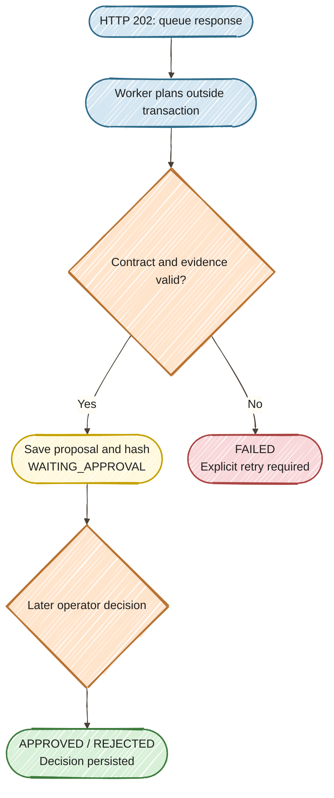

# Exercise 17 — Asynchronous Approval

<span class="badge badge--code-along">Code-Along</span> <span class="badge">Part 3 · 15 minutes</span>

**Persona:** Priya — IT service manager<br>
**Continue in:** `part3/lab/` (or the completed `part3/solution/`), **Approval & recovery** workspace.<br>
**File to edit:** `src/main/java/com/incidentmanagement/service/ResponseWorker.java`.

## Why this exercise

Priya, the incident manager, may approve a response minutes after generation. Keeping the original HTTP request or model invocation open is unnecessary. Persist the proposal and let a later, independent request record the decision.

This workshop uses a supplied, explicit database-backed state machine. It is not a Quarkus Flow engine checkpoint, distributed execution platform, or exactly-once remediation system.



## Step 1 — Enable the worker (4 min)

In `ResponseWorker.tick()`, add the worker call below the existing recovery scan:

```java
store.recover(Instant.now().minusSeconds(lease));
processNext();
```

The supplied `processNext()` claims one queued request in a short transaction, calls the declarative `ResponseAgent` outside that transaction, then persists the valid proposal and its SHA-256 hash. A failed model/contract check produces `FAILED` and requires an explicit retry. The scheduler skips overlapping invocations within this application instance.

Save and keep dev mode running. There are no new dependencies or infrastructure commands.

## Step 2 — Submit and inspect (5 min)

Select **Approval & recovery**, keep incident **#1**, and submit the default report. The page displays **HTTP 202** immediately. The saved state progresses from `QUEUED` through `PLANNING` to `WAITING_APPROVAL`. A fast run may skip visibly rendering the intermediate state; the audit contains it.

Record the request ID, proposal hash and attempt count. Click **Submit response** again with the **same ID and unchanged report**. It must return the existing request; the planning attempt count stays at one. Changing the payload while keeping that ID produces HTTP 409.

The browser polls saved state only. Polling cannot invoke a model, retry work, or approve a proposal.

## Step 3 — Record a decision, then leave one waiting (6 min)

Approve the first request. The saved record becomes `APPROVED`, with no new model call. The incident remains unchanged: approval records the proposed response decision and does not run production actions.

The decision includes the displayed proposal hash. A stale or altered hash gets HTTP 409. Repeating the same decision is idempotent; changing an accepted approval to rejection is a conflict. These checks are supplied in `ResponseStore` and covered by regression tests.

Click **New request ID**, submit a second request, and **leave it in WAITING_APPROVAL**. Keep its ID and hash for Exercise 18. Do not submit another request in the next exercise merely to demonstrate recovery.

## Done when

- [ ] HTTP 202 returns before model work and approval finish.
- [ ] Duplicate submission reuses the request without increasing the attempt count.
- [ ] One decision is saved, and a second proposal remains waiting for Exercise 18.

This is a local workshop with one running app and one operator, not an authenticated approval service. Production identity, authorization and multi-instance worker coordination are outside this timebox.

[Next: Exercise 18 — Restart Recovery](../18-restart-recovery/START_HERE.md).
