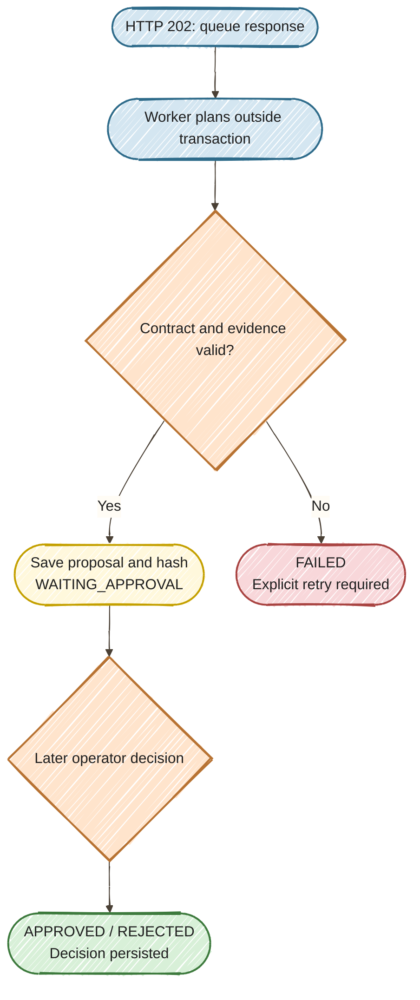
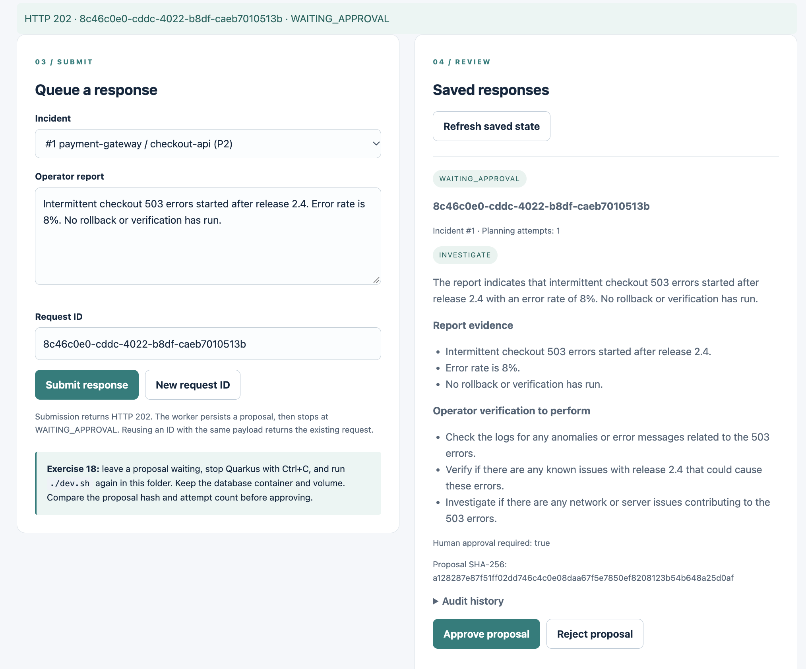
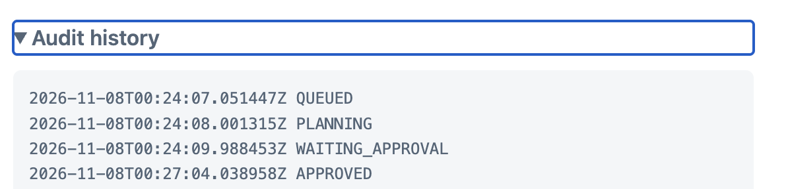
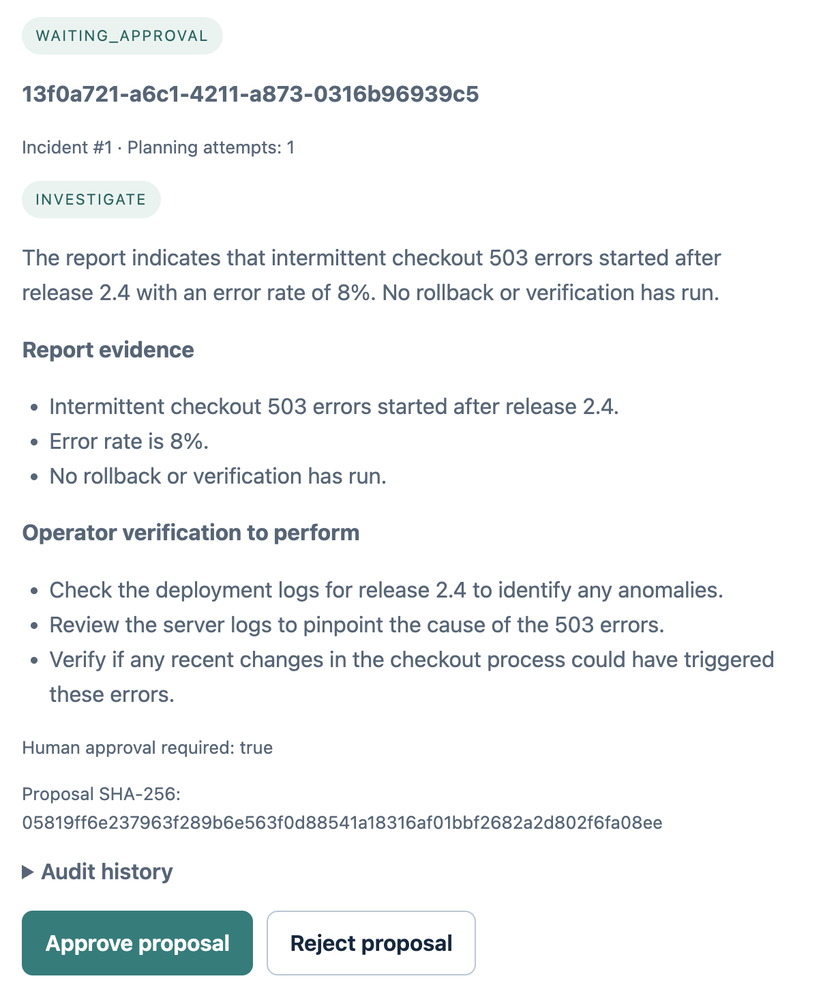

# Exercise 17 — Asynchronous Approval

<span class="badge badge--code-along">Code-Along</span> <span class="badge">Part 3 · 15 minutes</span>

**Persona:** Priya — IT service manager<br>
**Continue in:** `part3/lab/` (or the completed `part3/solution/`), **Approval & recovery** workspace.<br>
**Files to edit:**

- `src/main/java/com/incidentmanagement/service/ResponseWorker.java`

## Enterprise context and goal

Priya, the IT service manager, may review an incident response minutes after it is generated. She needs a saved proposal she can inspect and approve later, with a decision tied to that exact proposal. Operators also need duplicate submissions to reuse the existing request rather than start another planning attempt. Keeping the original HTTP request or model invocation open does not support this handoff.

Connect the supplied asynchronous worker, submit a response request, and inspect its saved proposal and hash. Record one approval through a later, independent request, then leave a second proposal waiting for Exercise 18. Approval records a human decision; it does not execute remediation or resolve the incident.

This workshop uses a supplied, explicit database-backed state machine. It is not a Quarkus Flow engine checkpoint, distributed execution platform, or exactly-once remediation system.



## Step 1 — Enable the worker (4 min)

In `ResponseWorker.tick()`, add the worker call below the existing recovery scan:

```java
store.recover(Instant.now().minusSeconds(lease));
processNext();
```

The supplied `processNext()` claims one queued request in a short transaction, calls the declarative `ResponseAgent` outside that transaction, then persists the valid proposal and its SHA-256 hash. A failed model/contract check produces `FAILED` and requires an explicit retry. The scheduler skips overlapping invocations within this application instance.

Save and keep dev mode running. There are no new dependencies or infrastructure commands.

## Step 2 — Submit and inspect (5 min)

Select **17–18 · Approval & recovery**, keep incident **#1**, and submit the default report. The page displays **HTTP 202** immediately. The saved state progresses from `QUEUED` through `PLANNING` to `WAITING_APPROVAL`. A fast run may skip visibly rendering the intermediate state; the audit contains it.

Record the request ID, proposal hash and attempt count. Click **Submit response** again with the **same ID and unchanged report**. It must return the existing request; the planning attempt count stays at one. Changing the payload while keeping that ID produces HTTP 409.

The browser polls saved state only. Polling cannot invoke a model, retry work, or approve a proposal.

[{ width="700" loading="lazy" }](../images/ex17-waiting-approval.png)
{: .planning-screenshot }

*Example saved response awaiting approval: the request ID matches the submission, planning attempts remain at 1, and the proposal hash identifies the exact recommendation. Your ID, hash, and generated text will differ. Click the image for a larger view.*
{: .planning-screenshot }

## Step 3 — Record a decision, then leave one waiting (6 min)

Approve the first request. The saved record becomes `APPROVED`, with no new model call. The incident remains unchanged: approval records the proposed response decision and does not run production actions.

Expand **Audit history** to inspect `QUEUED → PLANNING → WAITING_APPROVAL → APPROVED`.

[{ width="600" loading="lazy" }](../images/ex17-approved-audit-history.png)
{: .planning-screenshot }

*Example audit history after approval. **APPROVED** records the human decision; it does not mean remediation ran. Your timestamps will differ. Click the image for a larger view.*
{: .planning-screenshot }

The decision includes the displayed proposal hash. A stale or altered hash gets HTTP 409. Repeating the same decision is idempotent; changing an accepted approval to rejection is a conflict. These checks are supplied in `ResponseStore` and covered by regression tests.

Click **New request ID**, submit a second request, and **leave it in WAITING_APPROVAL**. Keep its ID and hash for Exercise 18. Do not submit another request in the next exercise merely to demonstrate recovery.

[{ width="450" loading="lazy" }](../images/ex17-second-request-waiting.png)
{: .planning-screenshot }

Example second request: **new Request ID** `13f0a721-a6c1-4211-a873-0316b96939c5`, **WAITING_APPROVAL**, and **Planning attempts: 1**. Your ID and proposal hash will differ. **Leave this request unapproved for Exercise 18.** Click the image for a larger view.
{: .planning-screenshot }

<div class="done-when" markdown>

## :material-check-circle: Done when

- [ ] HTTP 202 returns before model work and approval finish.
- [ ] Duplicate submission reuses the request without increasing the attempt count.
- [ ] One decision is saved, and a second proposal remains waiting for Exercise 18.

</div>

This is a local workshop with one running app and one operator, not an authenticated approval service. Production identity, authorization and multi-instance worker coordination are outside this timebox.

[Next: Exercise 18 — Restart Recovery](../18-restart-recovery/START_HERE.md).
