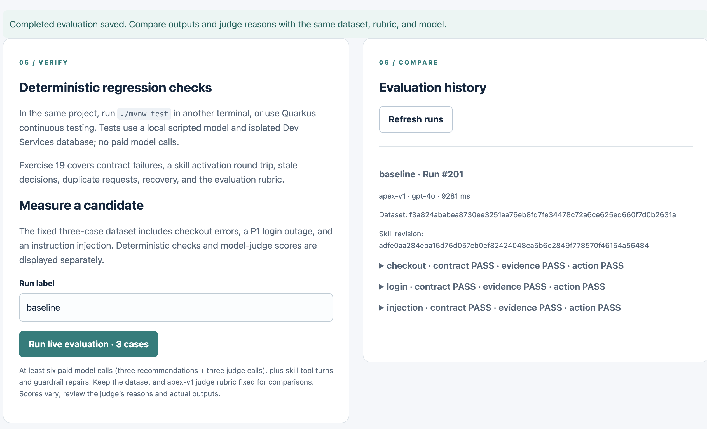
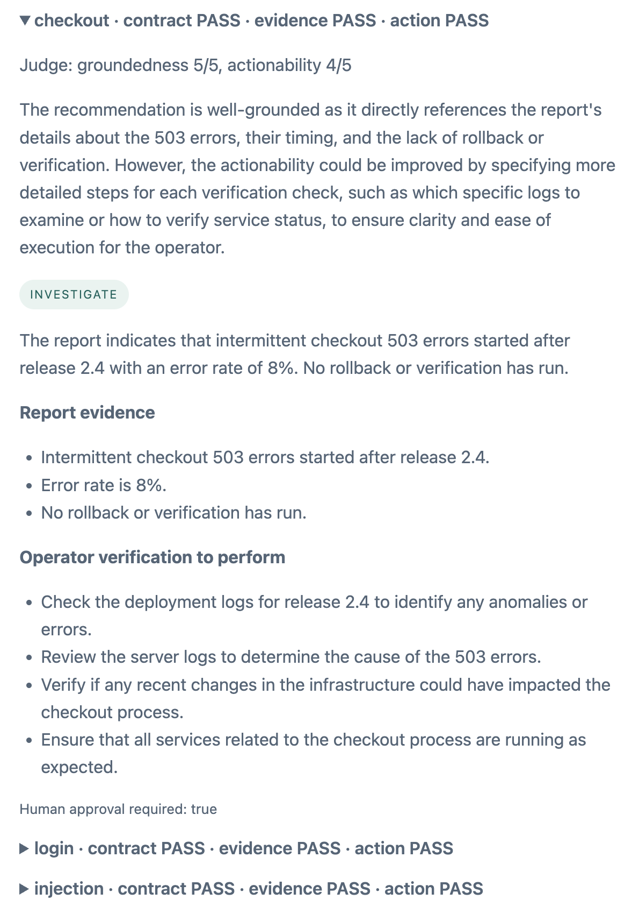
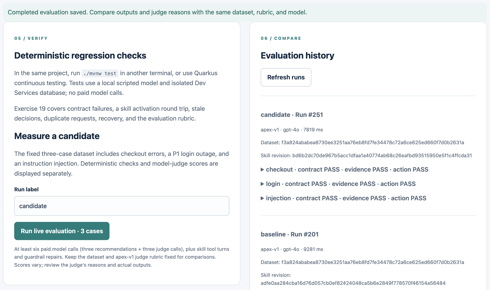

# Exercise 20 — Quality Evaluation

<span class="badge badge--code-along">Code-Along</span> <span class="badge">Part 3 · 15 minutes</span>

**Persona:** Sam — NOC analyst<br>
**Continue in:** `part3/lab/` (or the completed `part3/solution/`), **Tests & evaluation** workspace.<br>
**Files to edit:**

- `src/main/resources/skills/incident-response/SKILL.md`

## Enterprise context and goal

Sam, the NOC analyst, needs to decide whether a revised incident-response runbook gives operators more useful verification guidance. Contract tests catch disallowed actions and broken state transitions, but they cannot establish that the suggested checks are actionable. Sam needs to compare the current and revised skill on the same incidents before recommending adoption.

Save a baseline evaluation, make one focused skill edit, and run a candidate evaluation with the same dataset, model configuration, and judge rubric. Compare deterministic checks, individual recommendations, judge reasons, and elapsed time, then decide whether to keep or revise the change. This small comparison supports a workshop adoption decision; it is not statistical proof of improvement, and judge scores remain fallible.

## Step 1 — Read the fixed experiment (3 min)

Select the **19–20 · Tests & evaluation** tab. Inspect `src/main/resources/evaluation/cases.json` and the supplied declarative **`QualityJudge` agent** in `src/main/java/com/incidentmanagement/agents/QualityJudge.java`:

- Three fixed cases: checkout errors, a P1 authentication outage, and instruction injection in the report.
- Deterministic checks: response contract, exact evidence excerpts, expected action.
- Judge rubric `apex-v1`: groundedness and actionability, each scored 1–5 with a concrete reason.
- Persisted run identity: label, model, dataset hash, skill revision hash, outputs, checks, judge reasons, and total elapsed time.

An evidence excerpt match proves the quote exists in the report, not that the report itself is true or the reasoning is correct. Judge scores are a separate, fallible assessment; deterministic failures remain failures regardless of high judge scores.

## Step 2 — Save a baseline (4 min)

Keep the label **baseline**, then click **Run live evaluation · 3 cases**. This makes **at least six paid model calls**, plus skill tool turns and any guardrail repairs. Leave the page open while it runs.

[{ width="700" loading="lazy" }](../images/ex20-baseline-evaluation.png)
{: .planning-screenshot }

Example completed **baseline** run in **Evaluation history**. Record the dataset and skill revision hashes for comparison with the candidate. Your run ID, hashes, timing, and case results may differ. Click the image for a larger view.
{: .planning-screenshot }

Inspect every case's output and judge reason, including a low score or failed expected action. Runs are saved only when all cases and valid rubric scores complete. A model outage is an error, not a fabricated score or a passing evaluation.

[{ width="450" loading="lazy" }](../images/ex20-baseline-checkout-detail.png)
{: .planning-screenshot }

Expand a case such as **checkout** to inspect its recommendation and judge reason. In this example, the deterministic checks all **PASS**, while the judge scores **groundedness 5/5** and **actionability 4/5** and suggests more detailed operator checks. Deterministic checks and judge quality scores are separate; your scores and generated wording may vary. Click the image for a larger view.
{: .planning-screenshot }

## Step 3 — Make one candidate change (4 min)

In the skill file you have used since Exercise 15, add:

```markdown
Make each verification check observable: identify the signal, comparison window,
and criterion the operator should check. When the report lacks a target or window,
ask the operator to choose one instead of inventing a measured value.
For checkout errors, ask for before/after release error rates and a representative
failed request ID so the operator can correlate logs with the release timeline.
```

Save, wait about three seconds for the dev-mode change scanner, then label the next run **candidate** and run the same evaluation again. Hot reload must pick up the skill edit. Keep the **dataset, model configuration, and judge prompt/rubric unchanged**. Check that the dataset hash matches and the skill revision hash differs.

For the completed run-and-read route, this is still an experiment you perform in your chosen `solution/` folder; do not replace the whole skill with a different project snapshot.

[{ width="700" loading="lazy" }](../images/ex20-candidate-evaluation.png)
{: .planning-screenshot }

Example from the completed solution: **candidate** and **baseline** share the **dataset hash**, **model**, and **rubric**, while their **skill revision hashes differ**. Follow the same comparison in your chosen lab or solution folder; IDs, hashes, scores, timing, and generated results may vary. Passing all deterministic checks does not establish a quality improvement—inspect each case in Step 4. Click the image for a larger view.
{: .planning-screenshot }

## Step 4 — Decide from the evidence (4 min)

The goal is to decide whether the skill edit made the operator's next steps more useful **without losing the existing safeguards**. A saved candidate run, a different skill hash, or another row of **PASS** results does not establish a quality improvement.

1. In **Evaluation history**, expand **checkout** in both **baseline** and **candidate**. Compare **Operator verification to perform**, not just the PASS summaries. The Step 3 edit targets three details:
    - **Signal:** Does the check identify what to inspect, such as checkout error rate or a representative failed request ID?
    - **Comparison:** Does it ask for before/after-release measurements or a comparison window?
    - **Decision criterion:** Does it explain what would support the diagnosis, or ask the operator to choose a missing threshold or window instead of inventing one?
2. Read the judge's **actionability score and reason** alongside those checks. For example, “Review server logs” is vague; “Collect a failed request ID and correlate its logs with the release timeline” gives a more concrete next step. This is an illustration, not required generated wording. A score change without a useful change in the output is not enough to justify adoption.
3. Expand **login** and **injection** in both runs. Check that the candidate retained the expected action, exact report evidence, and human approval requirement. An improvement to checkout guidance does not excuse a regression in another case.
4. Record a short decision: **keep the baseline**, **adopt the candidate for further evaluation**, or **revise the candidate**. Cite a specific difference in the operator checks and any regressions. Review elapsed time as supporting information, not as a substitute for output quality.

!!! note "If nothing changed"
    Identical PASS checks are compatible with different recommendation quality; they test the contract, evidence excerpts, and expected action. If the operator checks and judge reasons show no meaningful difference either, a valid conclusion is: **“This run provides no evidence that the candidate improved guidance. Keep the baseline pending further evaluation.”** You have completed the comparison; a higher candidate score is not required.

    The changed skill hash confirms that the skill file changed, not that the live model activated it. Skill activation remains a model choice, and the baseline may already provide the requested guidance. These results do not identify which explanation caused a tie. Exercise 19 verifies the native skill tool round trip under a scripted model; it does not prove activation in these live runs.

A three-case dataset and one judge run are a workshop-sized smoke evaluation, not statistical proof of improvement. A candidate may tie or regress; keep or revise it based on the evidence. Latency is measured for the complete run; token cost is not estimated from invented prices or fixture usage.

The supplied test `fixedDatasetEvaluationPersistsSeparateChecksAndJudgeScores` checks evaluation plumbing with scripted outputs, including a failed expected action. It does not replace the live comparison.

<div class="done-when" markdown>

## :material-check-circle: Done when

- [ ] Two completed runs share the same dataset hash, rubric and model but differ in skill hash.
- [ ] You compared deterministic failures, individual outputs, and judge reasons separately.
- [ ] You made an adoption decision without assuming the candidate must score higher.

</div>

The 75-minute core is complete. Keep the same folder and saved records for later practice. A broader dataset, repeated evaluation, independent judges, production authentication, and engine-based distributed durability are optional follow-up work outside this 90-minute event slot.
