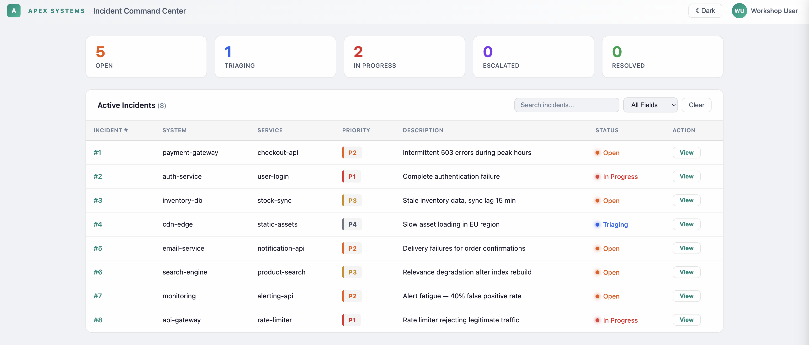

# Enterprise Agentic AI: Architecting Autonomous Java Systems for Production

**Three workshop parts · Separate 90-minute event slots**

!!! tip "Quick access"
    Short URL for this guide: **[bit.ly/agents-labs](https://bit.ly/agents-labs){:target="_blank"}** — share it or bookmark it.

    [:fontawesome-solid-file-pdf: Intro slide deck](images/intro-deck.pdf){:target="_blank" .md-button }

Build intelligent, secure, and observable multi-agent applications on **Quarkus**. **Part 1** introduces agents, supervisor orchestration, human-in-the-loop approval, OpenTelemetry tracing, and A2A remote agents. **Part 2** adds required MCP evidence, validated planning, memory eviction and isolation, majority-or-review voting, and persisted Kafka processing outcomes. **Part 3** adds runtime skills, output guardrails, asynchronous approval, full-restart recovery, deterministic regression tests, and quality evaluation. Each part fits its own 90-minute event slot; Parts 2 and 3 each have 75 minutes of core labs and 15 minutes of session overhead.

## Prerequisites

Confirm these before the workshop starts:

| Requirement | Check |
|-------------|-------|
| **[Java 25+](#install-java-25)** | `java -version` and `javac -version` |
| **[Maven 3.9+](#install-maven-39)** | `mvn -version`, or use `./mvnw` in each exercise |
| Quarkus | `./mvnw quarkus:dev` |
| [OpenCode CLI](https://opencode.ai/){:target="_blank"} or any AGENTS.md-compatible AI assistant | Install and configure before the workshop |
| LLM API key | `OPENAI_API_KEY` (OpenAI, Anthropic, or compatible provider) |
| Free ports **8080**, **8888** | One process per exercise set |
| Docker or Podman | For Quarkus Dev Services (PostgreSQL, LGTM, and Kafka in Part 2) |

### Install Java 25

Install a **JDK 25** so you have both the Java runtime and compiler. [Eclipse Temurin 25](https://adoptium.net/temurin/releases/?version=25){:target="_blank"} provides packages for different operating systems and CPU architectures; choose the latest available Java 25 patch release.

=== "macOS — Homebrew"

    With [Homebrew](https://brew.sh/){:target="_blank"} installed, install [Temurin 25](https://formulae.brew.sh/cask/temurin@25){:target="_blank"} and select it for the current terminal:

    ```bash
    brew install --cask temurin@25
    export JAVA_HOME=$(/usr/libexec/java_home -v 25)
    export PATH="$JAVA_HOME/bin:$PATH"
    ```

    Add the two `export` lines to `~/.zshrc` to keep this selection in new Zsh terminals. If you use Bash, add them to your Bash startup file instead.

=== "Linux / WSL — SDKMAN!"

    Install [SDKMAN!](https://sdkman.io/install/){:target="_blank"} in Bash or Zsh (skip the first command if it is already installed):

    ```bash
    curl -s "https://get.sdkman.io" | bash
    source "$HOME/.sdkman/bin/sdkman-init.sh"
    sdk list java
    ```

    In the list, find the latest stable **Java 25** entry under **Temurin** and copy its full **Identifier** ending in `-tem`. Press `q` to exit the list. Replace `JAVA_25_IDENTIFIER` below with that identifier, then run:

    ```bash
    sdk install java JAVA_25_IDENTIFIER
    sdk use java JAVA_25_IDENTIFIER
    sdk default java JAVA_25_IDENTIFIER
    ```

    SDKMAN! sets `JAVA_HOME` and `PATH`; `sdk use` selects the JDK in this terminal, and `sdk default` selects it for new terminals. See the [SDKMAN! usage guide](https://sdkman.io/usage/){:target="_blank"}. For WSL, install the JDK inside WSL and run the workshop commands there.

=== "Windows — installer"

    Download the **Windows JDK 25 MSI installer** from [Eclipse Temurin](https://adoptium.net/temurin/releases/?version=25){:target="_blank"}. Run it and, on **Custom Setup**, enable both **Add to PATH** and **Set JAVA_HOME**. Finish installation, then reopen your terminal and IDE so they pick up the new environment. See the [official Windows installation guide](https://adoptium.net/installation/windows/){:target="_blank"}.

    If you use WSL for the workshop, follow the **Linux / WSL** tab instead.

Verify the selected JDK in the terminal you will use for the workshop:

```bash
java -version
javac -version
```

Both should report **25** (or a newer version). After cloning the repository below, run `./mvnw -version` from `lab/` and check that Maven also reports **Java version: 25** or newer (`.\mvnw.cmd -version` in Windows PowerShell). If Maven reports an older Java version, update `JAVA_HOME` to the JDK installation directory and put its `bin` directory first in `PATH`. Set your IDE's project JDK and Maven runner JDK to the same version.

### Install Maven 3.9+

Install [Java 25](#install-java-25) first, then choose an installation method below. See the [official Apache Maven installation guide](https://maven.apache.org/install.html){:target="_blank"} for more options.

!!! tip "Maven Wrapper — no separate Maven installation needed"
    The workshop projects include `mvnw` and `mvnw.cmd`. After cloning the repository, run `./mvnw -version` from `lab/` (or `.\mvnw.cmd -version` in Windows PowerShell). The wrapper downloads and uses the Maven version configured for that project; its first run requires internet access. The exercise commands already use the wrapper. A JDK is still required.

=== "macOS — Homebrew"

    With [Homebrew](https://brew.sh/){:target="_blank"} installed:

    ```bash
    brew install maven
    mvn -version
    ```

=== "Linux / WSL — SDKMAN!"

    After installing SDKMAN! as shown in the [Java setup](#install-java-25):

    ```bash
    source "$HOME/.sdkman/bin/sdkman-init.sh"
    sdk install maven
    mvn -version
    ```

    Accept the prompt to make Maven the default. If Maven is already installed through SDKMAN!, use `sdk list maven` to choose a stable **3.9.x** release and select it with `sdk install maven VERSION`, `sdk use maven VERSION`, and `sdk default maven VERSION`, replacing `VERSION` with the version from the list. Run these commands inside WSL if that is your workshop environment.

=== "Windows — binary ZIP"

    1. Download the latest stable **Maven 3.9.x Binary zip archive** from [Apache Maven downloads](https://maven.apache.org/download.cgi){:target="_blank"}.
    2. Extract it to a permanent folder, such as `C:\Tools`. Add the extracted Maven folder's **`bin` directory** to your user **Path** using **Edit environment variables for your account**. For example, Maven 3.9.16 would use `C:\Tools\apache-maven-3.9.16\bin`; use the version you actually extracted.
    3. Keep `JAVA_HOME` pointing to your **JDK 25** installation. Open a new PowerShell window and run:

        ```powershell
        mvn -version
        ```

Check that the output reports **Apache Maven 3.9 or newer** and **Java version: 25 or newer**. If `mvn` is not found, check Maven's `bin` entry in `PATH` and reopen the terminal. If the Java version is older, correct `JAVA_HOME` using the Java instructions above. Your globally installed `mvn` and a project's `./mvnw` can use different Maven versions; verify the command you plan to run.

## Get the code

```bash
git clone https://github.com/danieloh30/agentic-ai-java-workshop.git
cd agentic-ai-java-workshop
export OPENAI_API_KEY=sk-your-key-here

# Your working project — start here for Exercise 1
cd lab
./mvnw quarkus:dev
```

Open [http://localhost:8080](http://localhost:8080){:target="_blank"} — Incident Dashboard with 8 seeded incidents and status cards.
No agent behavior yet: that's Exercise 1.

!!! tip "Starting Part 2 instead?"
    From the repository root, run `cd part2/lab` and `./mvnw quarkus:dev` once. Keep that folder and terminal for all six exercises, selecting Planning / MCP, Memory, Voting, or Events / Replay in the dashboard. The completed route uses `part2/solution/`. PostgreSQL, Kafka, and the MCP fixture start up front; normal hot reload preserves existing exercise records. No manual reset or restart is needed between Part 2 exercises.



!!! tip "Reference solutions"
    Part 1 references live in `solutions/`. Parts 2 and 3 use `part2/solution/` and `part3/solution/`. Choose starter or completed code at the start of a part and keep that folder; compare individual files when stuck.

## Exercises

!!! tip "Starting Part 3 instead?"
    From the repository root, run `cd part3/lab`, export `OPENAI_API_KEY`, then run `./dev.sh`. Choose `part3/solution` for completed code. Keep that folder throughout Exercises 15–20. Follow [Exercise 15](15-runtime-skills/START_HERE.md) for setup and preflight. Exercise 18 deliberately restarts the JVM with the database retained.

### Part 1 — Fundamental Patterns

| Exercise | Time | Focus |
|----------|------|-------|
| [1. Agent + tool](01-first-agent/START_HERE.md) | 15 min | `TriageAgent` + `TriageTool` |
| [2. Policy as prompt](02-maintenance-agent/START_HERE.md) | 10 min | `DiagnosticAgent` + `@SystemMessage` as policy |
| [3. Parallel agents](03-parallel-workflow/START_HERE.md) | 10 min | `@ParallelMapperAgent` + `@Output` |
| [4. Supervisor orchestration](04-supervisor/START_HERE.md) | 15 min | Full multi-agent supervisor |
| [5. AI governance](05-ai-governance/START_HERE.md) | 10 min | `AGENTS.md` + OpenCode CLI |
| [6. Human gate + tracing](06-hitl-observability/START_HERE.md) | 10 min | Human-in-the-loop + OpenTelemetry |
| [7. Remote agents (A2A)](07-a2a/START_HERE.md) | 10 min | Distributed impact assessment agent |
| [8. Quality loop (bonus)](08-quarkus-flow/START_HERE.md) | 15 min | Programmatic loop with `AgenticServices.loopBuilder()` |

### Part 2 — From Patterns to Production (Advanced & Enterprise)

A separate **90-minute session**: six 10–15 minute exercises total 75 minutes, with 15 minutes for introduction, transitions, and troubleshooting. Use one shared project (`part2/lab/` or `part2/solution/`) and the same Quarkus dev-mode terminal from Exercise 9 through 14. Save edits for hot reload; select the dashboard mode rather than copying/resetting projects. Preflight container and dependency downloads before the session.

| Exercise | Time | Focus |
|----------|------|-------|
| [9. Structured Planning](09-plan-execute/START_HERE.md) | 15 min | Validated specialist plans, bounded review, and explicit recommendation readiness |
| [10. Required MCP Evidence](10-mcp-evidence/START_HERE.md) | 10 min | A required tool lookup before planning; fail closed when evidence is unavailable |
| [11. Memory Boundaries](11-memory-tiering/START_HERE.md) | 10 min | Conversation isolation and observable eviction from the PostgreSQL-backed window |
| [12. Voting and Disagreement](12-consensus-voting/START_HERE.md) | 15 min | Parallel specialist ballots and deterministic majority-or-review policy |
| [13. Event-Driven Processing](13-event-driven/START_HERE.md) | 10 min | A sequential agent workflow triggered by Kafka, with correlated outcomes |
| [14. Persistent Outcomes and Replay](14-persistent-outcomes/START_HERE.md) | 15 min | Reuse completed work after hot reload and inspect durable, duplicate-safe outcomes |

### Part 3 — Reliable Response and Evaluation

Six cumulative exercises in a separate **90-minute event slot**: **10 + 10 + 15 + 15 + 10 + 15 = 75 minutes**, with 15 minutes for introduction, transitions, and troubleshooting. Choose `part3/lab/` for code-along or `part3/solution/` for completed code, then stay in that folder throughout. The same Apex incident response moves from a runtime skill to a guarded recommendation, asynchronous approval, restart recovery, regression checks, and a measured quality experiment.

The supplied launcher starts persistent PostgreSQL before Quarkus dev mode. Edits use hot reload; **Exercise 18 deliberately restarts the JVM once** to prove a pending approval survives. No reset commands or per-exercise project switches are needed. Evaluation plumbing, the fixed dataset and scripted test server are supplied; learner tasks stay small.

| Exercise | Time | Workspace |
|----------|------|-----------|
| [15. Runtime Skills](15-runtime-skills/START_HERE.md) | 10 min | Skills & guardrails |
| [16. Runtime Output Guardrails](16-output-guardrails/START_HERE.md) | 10 min | Skills & guardrails |
| [17. Asynchronous Approval](17-async-approval/START_HERE.md) | 15 min | Approval & recovery |
| [18. Restart Recovery](18-restart-recovery/START_HERE.md) | 15 min | Approval & recovery |
| [19. Deterministic Regression Tests](19-regression-tests/START_HERE.md) | 10 min | Tests & evaluation |
| [20. Quality Evaluation](20-quality-evaluation/START_HERE.md) | 15 min | Tests & evaluation |

Start with [Exercise 15](15-runtime-skills/START_HERE.md) and preflight dependency/container downloads before the event. Live evaluation uses paid model calls; automated regression tests use a local scripted model and an isolated test database.

Start with the **[Lab Overview](00-intro/SPEAKER_NOTES.md)** to understand the scenario, architecture, and learning path.

## Repository layout

| Path | Purpose |
|------|---------|
| `lab/` | Your hands-on Quarkus project (stub files with `// TODO`) |
| `AGENTS.md` | Project context file for AI assistants — rules, agent inventory, and conventions loaded once to avoid repeated file scans |
| `docs/` | These lab instructions (this site) |
| `solutions/` | Reference solution projects for each exercise — copy files from here if you get stuck |
| `solutions/08-quarkus-flow/lab/` | Separate starter project for the bonus exercise (not the root `lab/`) |
| `part2/lab/` | Shared runnable starter for Exercises 9–14; keep dev mode running |
| `part2/solution/` | Completed shared Part 2 application |
| `part3/lab/` | Shared starter for Exercises 15–20, started with `./dev.sh` |
| `part3/solution/` | Completed Part 3 application |
